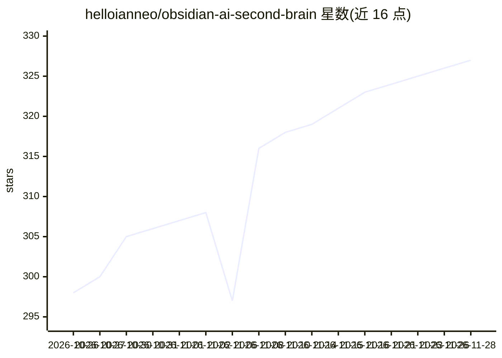

# helloianneo/obsidian-ai-second-brain

⭐ 327 · MIT · 推送 2026-10-27 · [GitHub](https://github.com/helloianneo/obsidian-ai-second-brain) · 个人维护 · 中文 README

**Obsidian+Claude 个人 AI 知识库零代码搭建教程**

一份图文教程仓库：指导用户在 Obsidian vault 中通过 Claudian 插件接入 Claude Code，配合仓库提供的 CLAUDE.md 规则文件，把个人笔记整理成 AI 维护的 wiki。流程分 4 个阶段 12 步，覆盖安装 Obsidian、Claude Code、Claudian 插件，建立 raw/wiki/assets 目录结构，以及 ingest（素材入库）、query（提问检索）、lint（索引体检）三个核心操作。不写代码，但需 Claude Pro/Max 订阅和约 30-60 分钟搭建时间。

## 筛选速览

| 维度 | 判定 | 备注 |
|---|---|---|
| AI 角色 | `ai-knowledge` | 知识聚合/清单类 |
| 许可风险 | `permissive` | MIT |
| 部署形态 | `library` | 以包/库形式分发 |
| 模型依赖 | locked-api |  |
| 硬件要求 | — | 无带数字的原话,不猜 |
| 安装摩擦 | `low` | 无编译、无系统依赖或容器化 |
| 成熟度 | — | 结构信号不足 |

## 能力要点

- 提供 CLAUDE.md 规则模板：定义 ingest/query/lint 三个触发行为
- raw/ 目录只读设计，保证原始素材不被 AI 修改
- 12 步零代码流程，覆盖安装、目录结构、日常使用与规则定制
- 通过 index.md 索引定位，支持数千篇文章规模的知识库

## 适用场景

- 把看过的文章、链接、截图交给 AI 整理成个人百科
- 用自然语言向自己的笔记提问并获得带引用的回答
- 定期体检修复知识库的失效链接和索引缺漏

## 场景标签

`知识库管理` `教程课程` `文档问答` · 领域:知识与检索

## 证据(README 行号)

> L1: # Obsidian + Claude AI 个人知识库完整搭建指南
> L7: **怎么用：** 把仓库里的 `CLAUDE.md` 复制到你的 Obsidian vault 根目录，按下面的步骤走一遍就行。或者直接把这份 README 扔给 AI 助手，让它一步步帮你配好目录结构、规则文件、索引和日志——你跟
> L213: ### Step 8：扔素材进去（Ingest）

## 星数曲线

2026-10-26 298 → 2026-11-28 327（+29）

---
*卡片 v1 · prompt 1.4 · 生成 2026-11-25 · 置信度 high · 依据 README sha `bdfb31977d57` · [字段定义](../../DATASET.md)*
