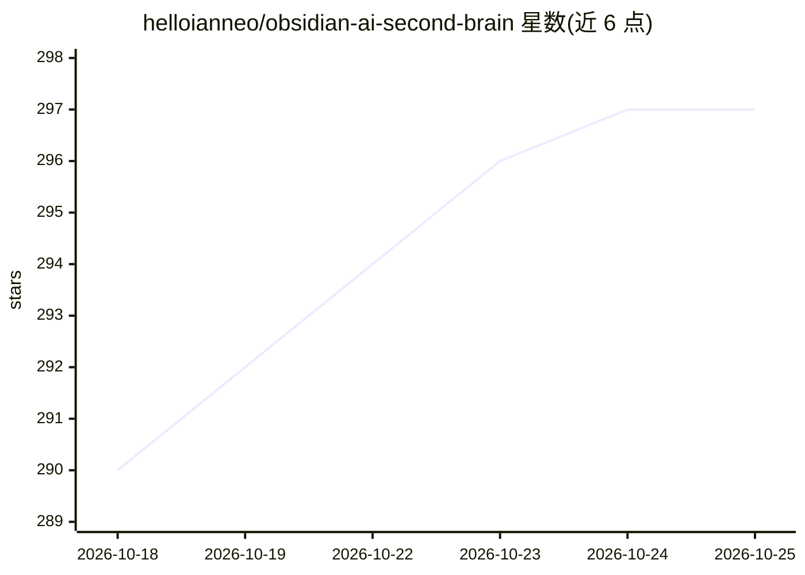

# helloianneo/obsidian-ai-second-brain

⭐ 297 · MIT · 推送 2026-04-13 · [GitHub](https://github.com/helloianneo/obsidian-ai-second-brain) · 个人维护 · 中文 README

**Obsidian+Claude 搭建个人知识库的免代码指南**

面向已用或愿意用 Obsidian 的普通用户的教程仓库：按 4 阶段 12 步指导安装 Obsidian、Claude Code 与 Claudian 插件，复制仓库中的 CLAUDE.md 规则文件，建立 raw/wiki/assets 目录结构。日常通过 ingest/query/lint 三类对话指令让 Claude 整理素材、回答提问、体检知识库，方法论来自 Karpathy LLM Wiki。依赖 Claude Pro/Max 付费订阅，Claudian 仅支持桌面端，本仓库本身不含可运行代码。

## 筛选速览

| 维度 | 判定 | 备注 |
|---|---|---|
| AI 角色 | `ai-knowledge` | 知识聚合/清单类 |
| 许可风险 | `permissive` | MIT |
| 部署形态 | `library` | 以包/库形式分发 |
| 模型依赖 | locked-api |  |
| 硬件要求 | — | 无带数字的原话,不猜 |
| 安装摩擦 | `low` | 无编译、无系统依赖或容器化 |
| 成熟度 | — | 结构信号不足 |

## 能力要点

- 提供 CLAUDE.md 规则文件模板，复制到 vault 即可用
- ingest/query/lint 三个核心操作的工作流定义
- raw/ 目录设为只读以保护原始素材
- 不要求写代码，搭建时间 30-60 分钟

## 适用场景

- 把日常看到的文章、PDF、截图整理成可提问的个人 wiki
- 基于自己笔记提问并获得带引用的回答
- 定期体检知识库的索引、链接与矛盾

## 场景标签

`知识库管理` `教程课程` · 领域:知识与检索

## 证据(README 行号)

> L7: **怎么用：** 把仓库里的 `CLAUDE.md` 复制到你的 Obsidian vault 根目录，按下面的步骤走一遍就行。或者直接把这份 README 扔给 AI 助手，让它一步步帮你配好目录结构、规则文件、索引和日志——你跟
> L171: 这是整个系统最核心的文件。`CLAUDE.md` 放在 vault 根目录，它告诉 AI：你的知识库结构是什么样的、遇到不同指令该怎么做。

## 星数曲线

2026-10-18 290 → 2026-10-25 297（+7）

---
*卡片 v1 · prompt 1.4 · 生成 2026-10-21 · 置信度 mid · 依据 README sha `a0c1ce110641` · [字段定义](../../DATASET.md)*
