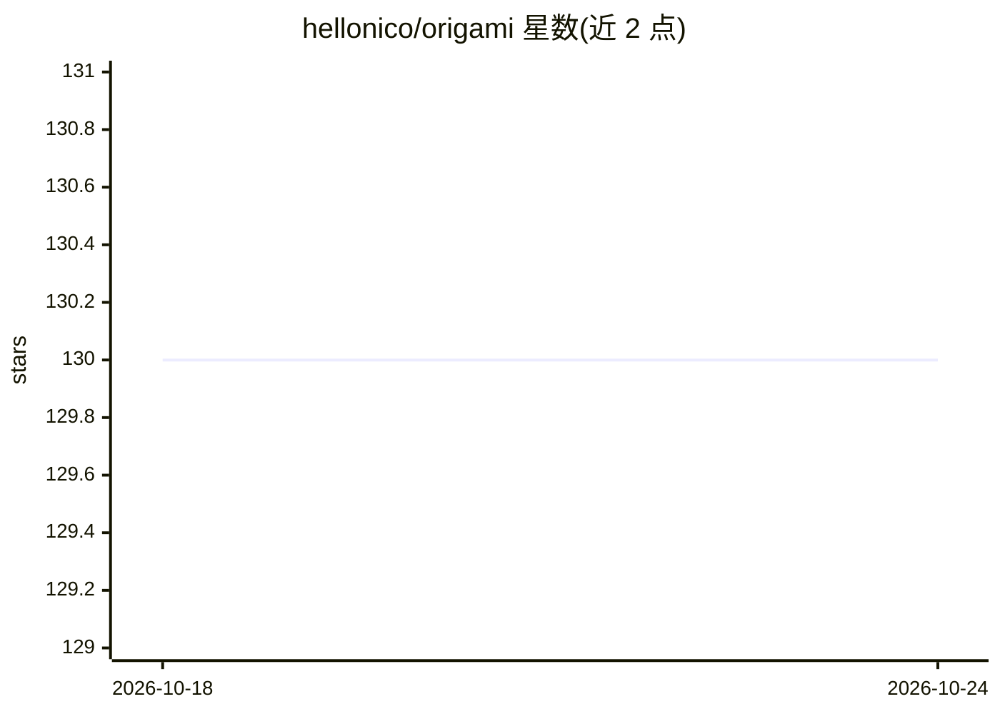

# hellonico/origami

⭐ 130 · Clojure · EPL-1.0 · 推送 2026-02-19 · [GitHub](https://github.com/hellonico/origami) · [官网](https://hellonico.github.io/origami-docs/#/) · 个人维护

**JVM 上使用 OpenCV 与神经网络的 Clojure/Java 绑定库**

在 Java 虚拟机上封装 OpenCV 4.9.0 的多语言绑定库：以 Clojure 为主，同时支持 Java、Kotlin、Scala 与 Bazel 二进制构建，覆盖 OSX、Windows、Linux、Raspberry Pi、Jetson 等平台。附带 origami-dnn 模块做深度神经网络推理（如 Yolo 系列），支持 CUDA 启用、AWS Lambda 运行、实时流服务器，以及从文件夹/zip/Dropbox/摄像头等来源惰性加载 OpenCV Mat 对象。通过 Clojars 分发，另提供 Booth、Yololi、Streamer、Viewer 等应用与 Jupyter notebook 环境。

## 筛选速览

| 维度 | 判定 | 备注 |
|---|---|---|
| AI 角色 | `ai-ecosystem` | LLM/agent 周边工具 |
| 许可风险 | `viral` | EPL-1.0 |
| 部署形态 | `None` |  |
| 模型依赖 | — | README 未给出锁定关系 |
| 硬件要求 | — | 无带数字的原话,不猜 |
| 安装摩擦 | `medium` | 含编译或系统依赖之一 |
| 成熟度 | — | 结构信号不足 |

## 能力要点

- 封装 OpenCV 4.9.0，提供 Clojure/Java/Kotlin/Scala 多语言接口
- origami-dnn 模块支持深度神经网络（Yolo 系列）
- 跨 OSX/Windows/Linux/Raspberry/Jetson 平台开箱运行
- 多种来源（zip/Dropbox/webcam/Flickr 等）惰性加载 Mat 与 VideoCapture

## 适用场景

- 在 JVM 项目中直接调用 OpenCV 图像处理与计算机视觉功能
- 用 Clojure 快速搭建目标检测（Yolo）原型
- 在树莓派/Jetson 等边缘设备上做视觉开发
- 构建实时视频流处理应用

## 场景标签

`图像视频处理` `目标检测` · 领域:感知与多模态

## 证据(README 行号)

> L3: - Lowest barrier of entry to Image Processing, Computer Vision and Neural Networks on the JVM
> L4:  - by using OpenCV (and when possible Clojure)
> L22: - Deep Neural Networks with origami-dnn

## 星数曲线

2026-10-18 130 → 2026-10-24 130（+0）

---
*卡片 v1 · prompt 1.4 · 生成 2026-10-22 · 置信度 high · 依据 README sha `e83e13509667` · [字段定义](../../DATASET.md)*
