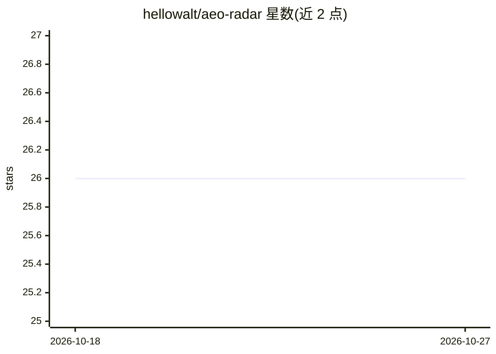

# hellowalt/aeo-radar

⭐ 26 · TypeScript · MIT · 推送 2026-07-01 · [GitHub](https://github.com/hellowalt/aeo-radar) · [官网](https://github.com/hellowalt/aeo-radar) · 个人维护 · 中文 README

**监测品牌在 AI 回答引擎中出现频率与排名的自托管工具**

面向品牌营销的开源 Answer Engine Optimization 监测工具：用 Playwright + stealth 插件每日无头爬取 ChatGPT（默认）网页版对设定关键词的回答，再经 Claude CLI 解析每条回答的品牌提及、排名、情感、竞品与引用 URL，结果存入 SQLite 并通过 Next.js 仪表盘展示。品牌、关键词、市场均由单一配置文件 brand.ts 驱动，每关键词扩展为 4 种意图提示。架构支持通过继承 BaseCrawler 接入 Gemini/Perplexity/Claude。README 明确提示自动化操作第三方 AI 服务存在违反 ToS 与账号被封风险，建议使用专用账号，并建议风险敏感场景改用 API 型工具。

## 筛选速览

| 维度 | 判定 | 备注 |
|---|---|---|
| AI 角色 | `ai-native` | 本体是模型或模型工具 |
| 许可风险 | `permissive` | MIT |
| 部署形态 | `None` |  |
| 模型依赖 | locked-api |  |
| 硬件要求 | — | 无带数字的原话,不猜 |
| 安装摩擦 | `low` | 无编译、无系统依赖或容器化 |
| 成熟度 | — | 结构信号不足 |

## 能力要点

- Playwright + stealth 无头爬取 ChatGPT 网页版，无需 API key
- 每条回答经 Claude CLI 解析出品牌提及、排名、情感、竞品、引用 URL
- 每关键词扩展为推荐/对比/教程/采购 4 种意图提示
- 单一 brand.ts 配置驱动全流程，SQLite 默认存储可换 Postgres

## 适用场景

- 每日追踪我的品牌在 ChatGPT 回答中的出现频率与排名
- 查看哪些竞品在 AI 回答中被更频繁推荐
- 用内置 14 天合成演示数据先行查看仪表盘效果

## 场景标签

`网页抓取` · 领域:效率与自动化

## 证据(README 行号)

> L12: > Open-source **Answer Engine Optimization** monitor. Track how often your brand shows up in AI answers, where you 
> L46: - **LLM-powered analysis** — each answer is parsed for brand mention, ranking position, sentiment, competitors, and

## 星数曲线

2026-10-18 26 → 2026-10-27 26（+0）

---
*卡片 v1 · prompt 1.4 · 生成 2026-10-26 · 置信度 high · 依据 README sha `1ca65071d1ed` · [字段定义](../../DATASET.md)*
