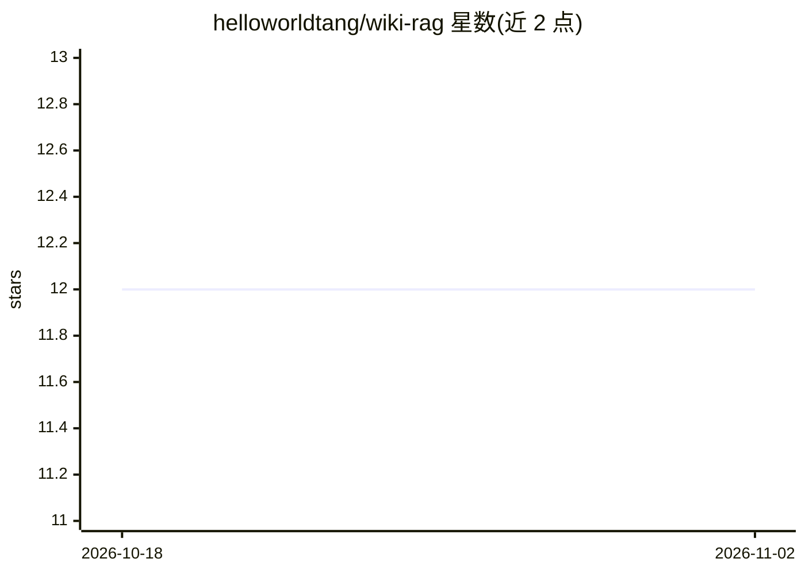

# helloworldtang/wiki-rag

⭐ 12 · Python · MIT · 推送 2026-09-26 · [GitHub](https://github.com/helloworldtang/wiki-rag) · 个人维护 · 中文 README

**个人笔记 RAG 系统：LLM 编译 Wiki，本地向量检索问答**

面向个人知识库的 RAG 教学项目：用 LLM（DeepSeek API 或本地 Ollama）把 raw/ 原始 Markdown 笔记编译为 wiki/ 结构化文章，再用 Ollama embedding 与 numpy 余弦相似度矩阵化检索实现问答；不依赖向量数据库与 RAG 框架，存储用 JSON 文件，核心代码不到 400 行且带 21 个测试。支持文件级增量编译、中文 bigram 降级检索、未命中不硬答；完全离线模式质量会下降。

## 筛选速览

| 维度 | 判定 | 备注 |
|---|---|---|
| AI 角色 | `ai-native` | 本体是模型或模型工具 |
| 许可风险 | `permissive` | MIT |
| 部署形态 | `None` |  |
| 模型依赖 | local-ok | 支持本地模型 |
| 硬件要求 | — | 无带数字的原话,不猜 |
| 安装摩擦 | `low` | 无编译、无系统依赖或容器化 |
| 成熟度 | — | 结构信号不足 |

## 能力要点

- LLM 把原始笔记编译为结构化 Wiki 再做向量检索，全程不用向量数据库
- 文件级增量：hash 未变复用旧 embedding，重复 compile 嵌入调用为 0
- Ollama 不可用时自动降级为字符 bigram 关键词匹配
- 核心代码不到 400 行，chunking/embedding/检索/prompt 组装全部手写并带测试

## 适用场景

- 把个人 Markdown 笔记变成可问答的知识库
- 阅读和魔改代码以理解 RAG 每一步原理
- 完全离线环境下用本地 Ollama 跑通 RAG 全链路

## 场景标签

`RAG` `文档问答` `教程课程` · 领域:知识与检索

## 证据(README 行号)

> L11: 个人笔记越攒越多，"存了但想不起来"。本项目用 LLM 把原始笔记编译成结构化 Wiki，再用向量检索让提问直达答案——**全程不依赖向量数据库和 RAG 框架**，适合想搞懂 RAG 每一步原理的人阅读和魔改。
> L67: - **向量检索**: numpy 余弦相似度，矩阵化一次计算

## 星数曲线

2026-10-18 12 → 2026-11-02 12（+0）

---
*卡片 v1 · prompt 1.4 · 生成 2026-11-01 · 置信度 high · 依据 README sha `fb45e7c329ff` · [字段定义](../../DATASET.md)*
