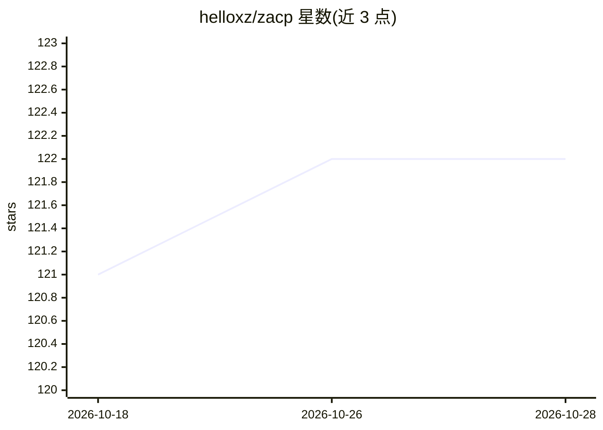

# helloxz/zacp

⭐ 122 · Go · NOASSERTION · 推送 2026-08-23 · [GitHub](https://github.com/helloxz/zacp) · [官网](https://note.xiaoz.top/doc/zacp) · 个人维护 · 中文 README

**基于 ACP 协议的多 Agent Web 网关，浏览器使用 CLI Agent**

Zacp 是用 Go（Gin + acp-go-sdk + SQLite）与 Vue 3 构建的 Web 网关，通过 ACP 协议接入 Codex、Reasonix、Grok、Omp、Qoder 等 CLI Agent，在浏览器提供会话式聊天界面，支持多会话、最多三个 Agent 并行任务、WebSocket 流式输出与权限确认推送。会话数据持久化到本地 SQLite，空闲会话自动回收。以单二进制发布，前端与默认配置内嵌，提供 macOS/Linux/Windows 一键安装与更新脚本，可选登录保护。自身无内置 Agent，需本地预先安装对应 CLI Agent。

## 筛选速览

| 维度 | 判定 | 备注 |
|---|---|---|
| AI 角色 | `ai-ecosystem` | LLM/agent 周边工具 |
| 许可风险 | `none` | NOASSERTION |
| 部署形态 | `None` |  |
| 模型依赖 | — | README 未给出锁定关系 |
| 硬件要求 | — | 无带数字的原话,不猜 |
| 安装摩擦 | `low` | 无编译、无系统依赖或容器化 |
| 成熟度 | — | 结构信号不足 |

## 能力要点

- 适配 Codex、Reasonix、Grok、Omp、Qoder 等多种 CLI Agent
- 浏览器 Web UI：多会话、流式输出、权限确认、最多三个并行任务
- 单二进制发布，前端与配置内嵌，一键安装/更新脚本覆盖三大平台
- 附带文件浏览器、Git 面板与 Web TTY 终端

## 适用场景

- 把只有 CLI 的 Agent 工具搬到浏览器里用
- 同时管理并切换多种 Agent 进行对话
- 远程访问时开启登录保护使用本地 Agent 集群

## 场景标签

`多智能体` `模型网关` · 领域:Agent 开发

## 证据(README 行号)

> L3: Zacp是一个基于 **ACP（Agent Client Protocol）** 协议的多 Agent Web 网关，让你在浏览器里同时使用多种 AI Agent 工具（如 Reasonix、Grok、Omp 等）进行对话，让原本不
> L24: - **多 Agent 接入**：适配 Codex、Reasonix、Grok、Omp、Qoder 等 CLI Agent

## 星数曲线

2026-10-18 121 → 2026-10-28 122（+1）

---
*卡片 v1 · prompt 1.4 · 生成 2026-10-23 · 置信度 high · 依据 README sha `694b4468895a` · [字段定义](../../DATASET.md)*
