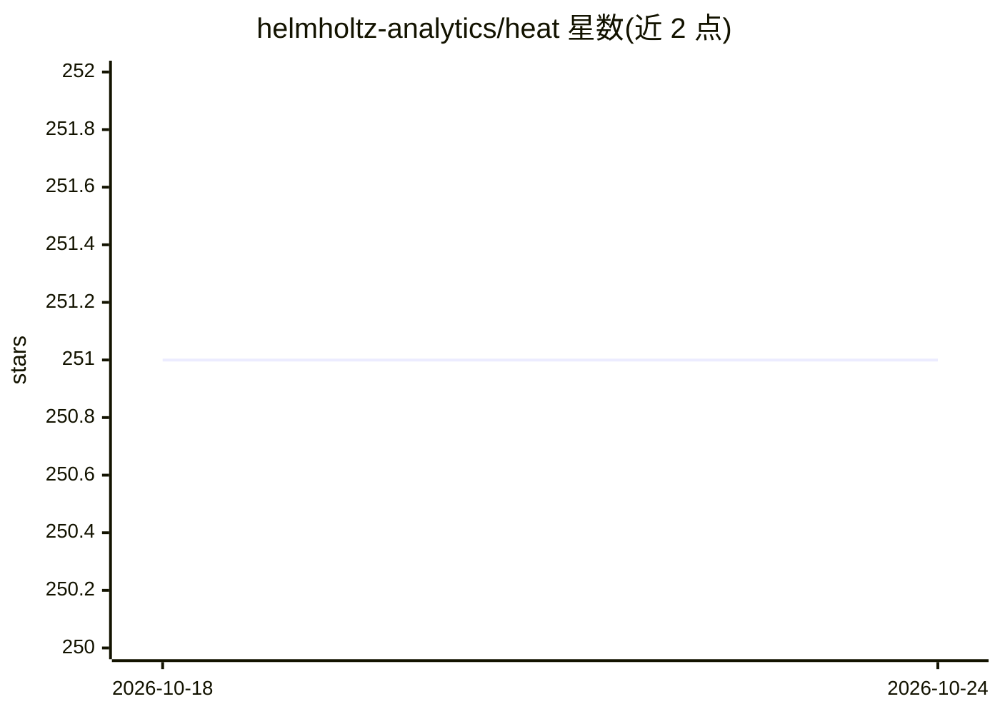

# helmholtz-analytics/heat

⭐ 251 · Python · 推送 2026-10-23 · [GitHub](https://github.com/helmholtz-analytics/heat) · [官网](https://heat.readthedocs.io/) · 组织维护

**科研/数据科学用户的分布式张量计算框架，跨多机处理超大规模数组**

基于 PyTorch 与 mpi4py 构建的分布式张量框架，提供 CPU、GPU（CUDA/ROCm/Apple MPS）与 MPI 集群上的张量算法与数据结构，用于处理超出单机内存的 massive arrays。支持将现有 NumPy/SciPy 代码以较小改动迁移到多节点集群，通过 DNDarray 的 split 与 device 属性控制数据分片与设备，节点间通信由框架自动处理。要求 Python>=3.12、MPI 实现（OpenMPI/MPICH/Intel MPI）、mpi4py>=3.1、pytorch>=2.6；以 pip 安装，可选 hdf5/netcdf/zarr I/O 支持；另提供 conda-forge 渠道。由 Helmholtz 机构团队维护，附 IEEE BigData 2020 论文。

## 筛选速览

| 维度 | 判定 | 备注 |
|---|---|---|
| AI 角色 | `ai-ecosystem` | LLM/agent 周边工具 |
| 许可风险 | `permissive` | — |
| 部署形态 | `library` | 以包/库形式分发 |
| 模型依赖 | — | README 未给出锁定关系 |
| 硬件要求 | — | 无带数字的原话,不猜 |
| 安装摩擦 | `medium` | 含编译或系统依赖之一 |
| 成熟度 | — | 结构信号不足 |

## 能力要点

- 基于 PyTorch+mpi4py 的分布式张量与算法库
- 支持 CPU、CUDA/ROCm/Apple MPS 与多节点 MPI 集群
- NumPy/SciPy 代码可低成本迁移到多机集群
- 通过 DNDarray.split/device 控制分片与设备，通信自动管理

## 适用场景

- 我的数组大到单机内存放不下，需要跨集群节点计算
- 把现有 NumPy/SciPy 分析代码扩展到多节点 HPC 环境
- 在 SLURM 集群上跑分布式线性代数等教程示例

## 场景标签

 · 领域:高性能计算/数据分析

## 证据(README 行号)

> L21: Heat is a distributed tensor framework built on **PyTorch** and **mpi4py**. It provides highly optimized algorithms
> L77: Götz, M., et al. (2020). HeAT - a Distributed and GPU-accelerated Tensor Framework for Data Analytics. In *2020 IEE

## 星数曲线

2026-10-18 251 → 2026-10-24 251（+0）

---
*卡片 v1 · prompt 1.4 · 生成 2026-10-22 · 置信度 high · 依据 README sha `9ef558ccfee6` · [字段定义](../../DATASET.md)*
