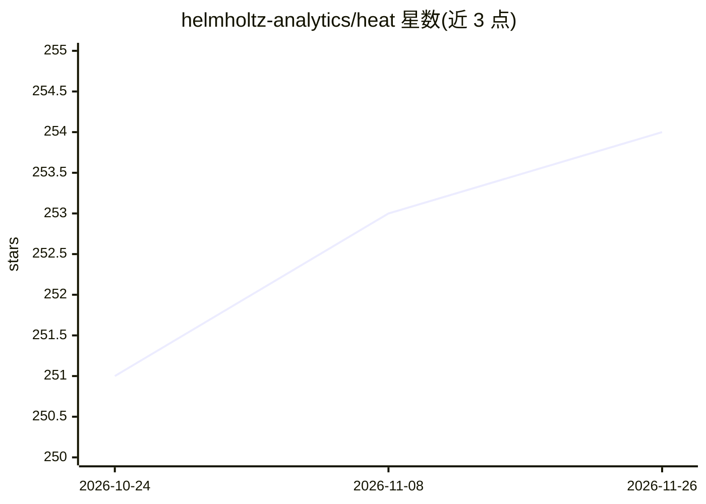

# helmholtz-analytics/heat

⭐ 254 · Python · 推送 2026-11-25 · [GitHub](https://github.com/helmholtz-analytics/heat) · [官网](https://heat.readthedocs.io/) · 组织维护

**分布式张量与机器学习框架：Python 高性能数据计算**

Heat 是构建在 PyTorch 与 mpi4py 之上的分布式张量框架，为 CPU、GPU（CUDA/ROCm/Apple MPS）及分布式集群系统提供张量计算的数据结构与算法，用于处理超出单机内存与算力上限的大规模数组。通过 DNDarray.split 控制数据分片、DNDarray.device 指定计算设备，节点间通信由框架自动处理；可在笔记本以 mpirun 运行，也可经 srun 提交 SLURM 集群作业。要求 Python>=3.12、MPI 与 mpi4py>=3.1、pytorch>=2.6，经 pip 或 conda 安装，另有浏览器内在线试用入口。

## 筛选速览

| 维度 | 判定 | 备注 |
|---|---|---|
| AI 角色 | `ai-native` | 本体是模型或模型工具 |
| 许可风险 | `permissive` | — |
| 部署形态 | `library` | 以包/库形式分发 |
| 模型依赖 | — | README 未给出锁定关系 |
| 硬件要求 | — | 无带数字的原话,不猜 |
| 安装摩擦 | `medium` | 含编译或系统依赖之一 |
| 成熟度 | — | 结构信号不足 |

## 能力要点

- 基于 PyTorch 与 mpi4py 的分布式张量框架，面向超单机内存的大规模数组
- 支持 CPU、GPU（CUDA/ROCm/Apple MPS）多硬件后端
- 通过 DNDarray.split/device 属性控制数据分片与计算设备
- 提供 mpirun 本地运行与 SLURM 集群 srun 运行示例

## 适用场景

- 把现有 NumPy/SciPy 代码以最小改动移植到多节点集群
- 在 HPC 集群上做内存密集型的分布式张量计算
- 利用集群累积内存跑超出单机容量的数组运算

## 场景标签

 · 领域:科学计算/高性能数据分析

## 证据(README 行号)

> L17: **High-performance data analytics in Python, at scale.**
> L22: Heat is a distributed tensor framework built on **PyTorch** and **mpi4py**. It provides highly optimized algorithms

## 星数曲线

2026-10-24 251 → 2026-11-26 254（+3）

---
*卡片 v1 · prompt 1.4 · 生成 2026-11-25 · 置信度 high · 依据 README sha `78fbd801d0b5` · [字段定义](../../DATASET.md)*
