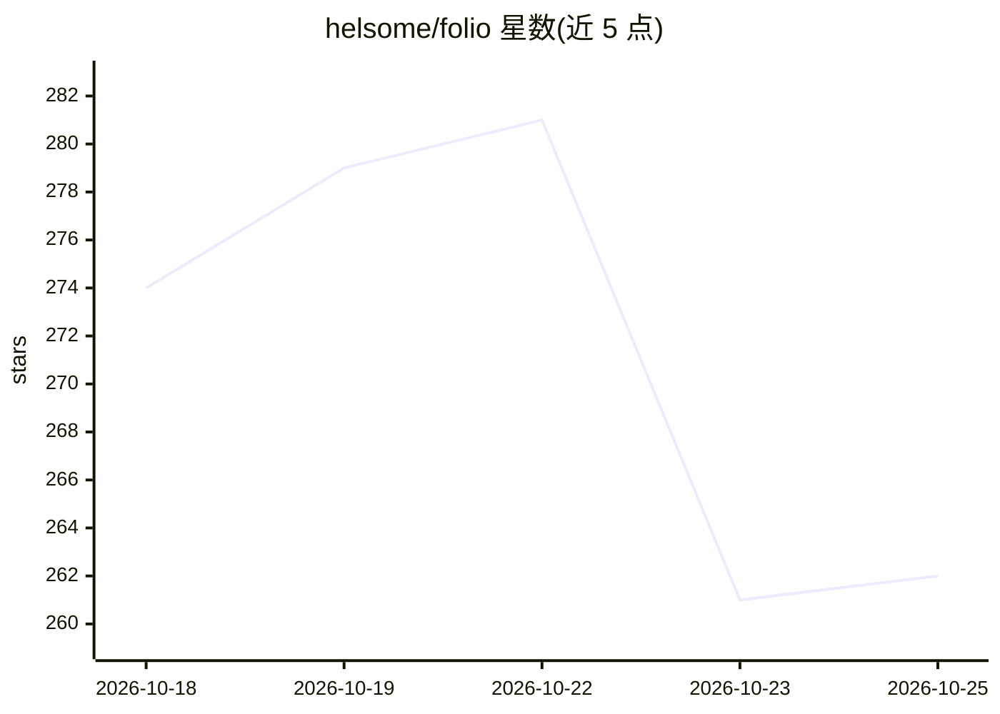

# helsome/folio

⭐ 262 · TypeScript · 推送 2026-10-25 · [GitHub](https://github.com/helsome/folio) · 个人维护 · 中文 README

**本地优先的 AI 投资研究桌面工作台：研究、论点与组合监控**

面向公开市场投资者的 Electron 桌面研究环境：自选清单、K 线、财务报表、新闻与多标的对比构成金融工作区；深度研究功能由结构化数据包经 Agent 综合生成带证据链接的研究报告，可保存为可编辑投资论点并随新数据重新评估。内置 Pi Agent 运行时的副驾驶、技能中心与 Agent 评测中心（含 86 案例基准集）。行情数据通过 Longbridge/Massive/Yahoo Finance 集成，未接入时展示带徽标的内置示例数据；会话与凭证默认本地存储，产品只读、不提供交易能力。当前为 beta（0.4.0-beta.2），提供 macOS arm64 构建。

## 筛选速览

| 维度 | 判定 | 备注 |
|---|---|---|
| AI 角色 | `ai-native` | 本体是模型或模型工具 |
| 许可风险 | `none` | — |
| 部署形态 | `None` |  |
| 模型依赖 | — | README 未给出锁定关系 |
| 硬件要求 | — | 无带数字的原话,不猜 |
| 安装摩擦 | `low` | 无编译、无系统依赖或容器化 |
| 成熟度 | `idea` | |

## 能力要点

- 结构化数据→Agent 综合→带证据链接的 ResearchReport
- 研究报告可保存为投资论点并基于新数据重新评估
- 内置 Evaluation Center 与 86 案例的 folio-agent-v1 基准集
- 未接入任何服务时以带徽标的示例数据完整运行（离线回退）

## 适用场景

- 跟踪自选股与投资组合敞口，监控价格/财报/评级变化
- 对持仓一键发起深度研究并保存为可追踪的投资论点
- 在本地桌面端与 Agent 副驾驶对话完成投资研究

## 场景标签

`金融量化` · 领域:学习与行业

## 证据(README 行号)

> L18: Folio 是为公开市场投资者打造的桌面研究环境。它将安静整洁的金融工作区与 Agent 副驾驶（copilot）相结合——Agent 可以获取结构化的行情数据、解释证据，并将研究持续推进到投资论点、提醒与投资组合决策中。
> L63: - 结构化数据包 → Agent 综合 → 基于证据的 `ResearchReport`。
> L68: - 由 Pi Agent 运行时驱动的持久会话与流式回答。

## 星数曲线

2026-10-18 274 → 2026-10-25 262（-12）

---
*卡片 v1 · prompt 1.4 · 生成 2026-10-22 · 置信度 high · 依据 README sha `a68bc674da96` · [字段定义](../../DATASET.md)*
