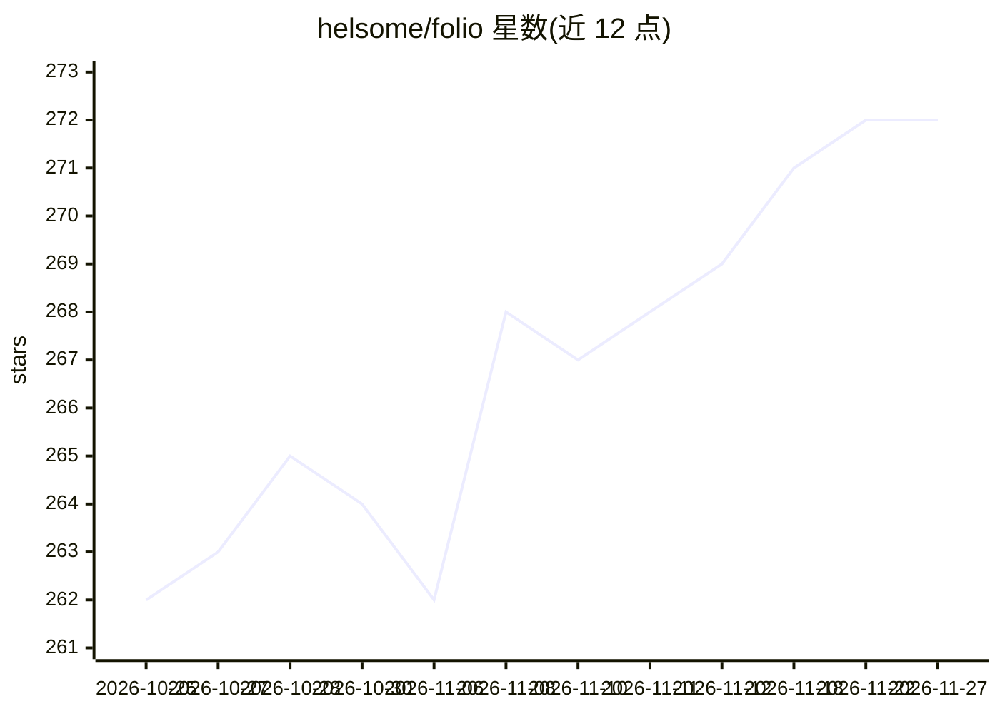

# helsome/folio

⭐ 272 · TypeScript · 推送 2026-11-12 · [GitHub](https://github.com/helsome/folio) · 个人维护 · 中文 README

**面向公开市场投资者的本地优先 AI 投资研究工作台**

基于 Electron 的桌面投资研究环境：中间为金融工作区（自选、K 线、财报、新闻、研究报告、对比、组合），右侧常驻 Agent 副驾驶。深度研究按「规划→并行能力调用→模型综合→报告」产出含立场、置信度与证据表的报告，可保存为可复核的投资逻辑。数据源显式接入 Yahoo Finance（免密钥延迟行情）与可选的 Longbridge/Massive；LLM 经 Pi 运行时对接 OpenAI 兼容端点。产品只读，不提供下单；会话与凭证默认留在本机。当前版本 0.4.0-beta.2，仅提供 macOS arm64 打包。

## 筛选速览

| 维度 | 判定 | 备注 |
|---|---|---|
| AI 角色 | `ai-native` | 本体是模型或模型工具 |
| 许可风险 | `none` | — |
| 部署形态 | `None` |  |
| 模型依赖 | — | README 未给出锁定关系 |
| 硬件要求 | — | 无带数字的原话,不猜 |
| 安装摩擦 | `low` | 无编译、无系统依赖或容器化 |
| 成熟度 | `idea` | |

## 能力要点

- 深度研究生成带证据表、立场与置信度的 ResearchReport，支持 Research Diff 对比
- Agent 副驾驶显示工具活动与来源检查器，工具失败时说明数据缺口
- 17 个确定性筛选任务的机会发现，规则驱动而非模型扫描
- 内置评测中心与 folio-agent-v1（86 案例）基准集，可接 LangSmith/Langfuse

## 适用场景

- 对一只股票发起结构化深度研究并保存投资逻辑供后续复核
- 本地查看自选股 K 线、财报与新闻，组合风险指标分析
- 与 Agent 对话查询当前页面标的的行情数据
- 对比 2–4 只标的的估值、成长与回报指标

## 场景标签

`金融量化` `模型评测` · 领域:评测与运维

## 证据(README 行号)

> L7:  本地优先的 AI 原生投资研究工作台
> L18: Folio 是面向公开市场投资者的桌面研究环境。左侧是导航，中间是金融工作区（自选、K 线、财报、新闻、研究报告），右侧常驻一个能看见当前页面和标的的 Agent 副驾驶。选中哪只股票，K 线、概览、研究和 Agent 上下文一起
> L233: - **模型：** Pi 运行时对接已配置的 LLM 提供方，包括 OpenAI 兼容的本地或远程端点。开发与离线黄金路径可以使用确定性本地运行时。

## 星数曲线

2026-10-25 262 → 2026-11-27 272（+10）

---
*卡片 v1 · prompt 1.4 · 生成 2026-11-25 · 置信度 high · 依据 README sha `c183809c43bb` · [字段定义](../../DATASET.md)*
