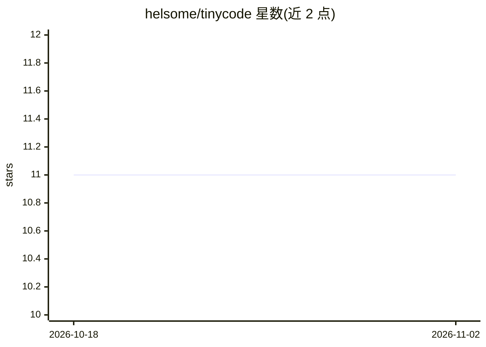

# helsome/tinycode

⭐ 11 · TypeScript · MIT · 推送 2026-08-26 · [GitHub](https://github.com/helsome/tinycode) · 个人维护

**约6千行的可通读 Coding Agent 教学框架，基于 Pi 运行时**

面向想理解 coding agent 内部机制的开发者，TinyCode 用约 6k 行 TypeScript 提供一个完整但可在一个下午读完的 agent 框架，覆盖模型接入、agent 循环、7 个内置工具、权限审批、JSONL 会话持久化、上下文压缩、技能加载、MCP 集成、只读子代理与流式 TUI。运行在 Pi 运行时（pi-agent-core/pi-ai/pi-tui）之上，可连接真实 LLM 提供商或使用离线 mock 模型。权限层是审批+工作区路径守卫而非 OS 沙箱，测试全程离线共 115 项。

## 筛选速览

| 维度 | 判定 | 备注 |
|---|---|---|
| AI 角色 | `ai-native` | 本体是模型或模型工具 |
| 许可风险 | `permissive` | MIT |
| 部署形态 | `library` | 以包/库形式分发 |
| 模型依赖 | locked-api |  |
| 硬件要求 | — | 无带数字的原话,不猜 |
| 安装摩擦 | `low` | 无编译、无系统依赖或容器化 |
| 成熟度 | — | 结构信号不足 |

## 能力要点

- 完整 agent 子系统：模型+循环+工具+权限+会话+上下文工程+技能+MCP+子代理+TUI
- 7 个内置工具（read/write/edit/bash/grep/find/ls）与只读子代理（最多 3 个）
- 无 API key 可用 mock 模型离线运行，115 项测试全程离线
- 权限审批对话框、symlink 感知的工作区边界与 JSONL 会话恢复

## 适用场景

- 通过阅读一个完整 agent 框架学习 coding agent 的运行机制
- 对照 ARCHITECTURE 文档理解各子系统（权限、上下文压缩、MCP）如何协作
- 用 mock 模型在无 key 环境下跑通真实 agent 循环做实验

## 场景标签

`Agent 框架` `教程课程` · 领域:Agent 开发

## 证据(README 行号)

> L21: It runs real tasks against real LLM providers — and because it is built on
> L17: Model  +  Agent Loop  +  Tools  +  Permissions  +  Session

## 星数曲线

2026-10-18 11 → 2026-11-02 11（+0）

---
*卡片 v1 · prompt 1.4 · 生成 2026-11-02 · 置信度 high · 依据 README sha `0a027ae858d0` · [字段定义](../../DATASET.md)*
