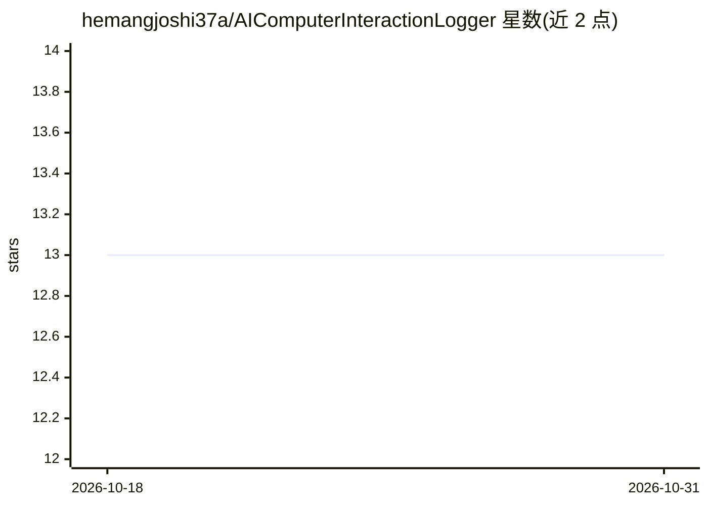

# hemangjoshi37a/AIComputerInteractionLogger

⭐ 13 · Python · MIT · 推送 2026-05-09 · [GitHub](https://github.com/hemangjoshi37a/AIComputerInteractionLogger) · [官网](https://hjlabs.in) · 个人维护

**记录人机交互并生成多模态 LLM 训练数据集的 Python 工具**

捕获并记录用户与计算机交互过程的 Python 工具：以可配置频率（默认 10 fps）截屏、记录鼠标坐标与点击/滚轮、键盘按键（可脱敏敏感输入）以及系统音频与麦克风，各数据流以同步时间戳组织为 events.csv、audio.wav 与截图目录的会话结构，供 ML 模型摄取。面向希望构建自主计算机控制 LLM 训练数据的研究者与开发者；数据全部本地存储、不联网传输。通过 git clone 与 pip install -r requirements.txt 安装，作为 Python 库（DatasetRecorder 类）调用。

## 筛选速览

| 维度 | 判定 | 备注 |
|---|---|---|
| AI 角色 | `ai-ecosystem` | LLM/agent 周边工具 |
| 许可风险 | `permissive` | MIT |
| 部署形态 | `library` | 以包/库形式分发 |
| 模型依赖 | — | README 未给出锁定关系 |
| 硬件要求 | — | 无带数字的原话,不猜 |
| 安装摩擦 | `low` | 无编译、无系统依赖或容器化 |
| 成熟度 | — | 结构信号不足 |

## 能力要点

- 截屏/鼠标/键盘/音频四类同步时间戳录制
- 键盘输入可掩码敏感数据（如密码）
- 输出 events.csv + PNG 截图 + WAV 音频的会话目录结构
- 数据本地存储、无网络传输

## 适用场景

- 为自主计算机控制任务采集多模态训练数据
- 录制自动化软件测试或 UX 分析的交互过程
- 构建带屏幕与输入事件的多模态 LLM 数据集

## 场景标签

 · 领域:AI 数据集生成/人机交互

## 证据(README 行号)

> L9:  Generate comprehensive datasets for training multi-modal LLMs in autonomous computer control
> L16: AI Computer Interaction Logger is a powerful tool designed to capture and log human-computer interactions, creating

## 星数曲线

2026-10-18 13 → 2026-10-31 13（+0）

---
*卡片 v1 · prompt 1.4 · 生成 2026-10-31 · 置信度 mid · 依据 README sha `a73c5f23e386` · [字段定义](../../DATASET.md)*
