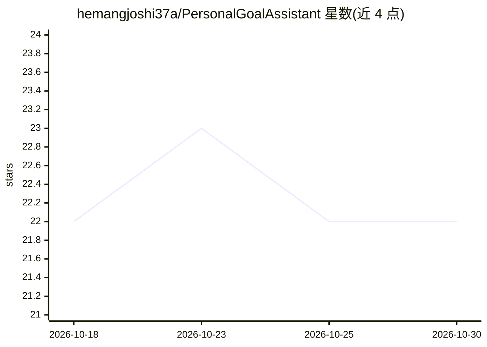

# hemangjoshi37a/PersonalGoalAssistant

⭐ 22 · JavaScript · MIT · 推送 2026-05-02 · [GitHub](https://github.com/hemangjoshi37a/PersonalGoalAssistant) · [官网](https://hjlabs.in/AIML/services/agentic-ai/) · 个人维护

**AI 目标规划与习惯追踪的 Web 应用（SPA）**

Flask 后端加 Vite 前端的单页应用，调用 Gemini 1.5 Flash 进行战略规划、动态日程生成与习惯追踪。包含任务拓扑 3D 可视化（Zenith Lab）、习惯连续性预测（Quantum Forge）、日程时间线（Chronos Engine）、个性画像生成与知识库图谱等模块。数据存于本地 SQLite，需用户提供 GEMINI_API_KEY。安装方式为 pip 装后端依赖、npm 装前端依赖后分别启动服务。

## 筛选速览

| 维度 | 判定 | 备注 |
|---|---|---|
| AI 角色 | `ai-native` | 本体是模型或模型工具 |
| 许可风险 | `permissive` | MIT |
| 部署形态 | `library` | 以包/库形式分发 |
| 模型依赖 | — | README 未给出锁定关系 |
| 硬件要求 | — | 无带数字的原话,不猜 |
| 安装摩擦 | `low` | 无编译、无系统依赖或容器化 |
| 成熟度 | — | 结构信号不足 |

## 能力要点

- Gemini 1.5 Flash 驱动战略规划与动态日程生成
- 习惯追踪与 streak 预测
- 任务拓扑 3D 可视化与 AI 推理流展示
- 本地 SQLite 存储，账号登录（Flask-Login）

## 适用场景

- 我用它制定并追踪个人目标的每日计划
- 记录习惯养成并查看连续性预测
- 以可视化方式查看任务结构与 AI 规划

## 场景标签

`AI 助手` · 领域:对话与助手

## 证据(README 行号)

> L3: A robust, AI-powered Single Page Application (SPA) designed to act as an autonomous executive coach and life manager
> L15: - **AI/LLM**: Google Gemini (1.5 Flash).

## 星数曲线

2026-10-18 22 → 2026-10-30 22（+0）

---
*卡片 v1 · prompt 1.4 · 生成 2026-10-27 · 置信度 high · 依据 README sha `6dbe247ebace` · [字段定义](../../DATASET.md)*
