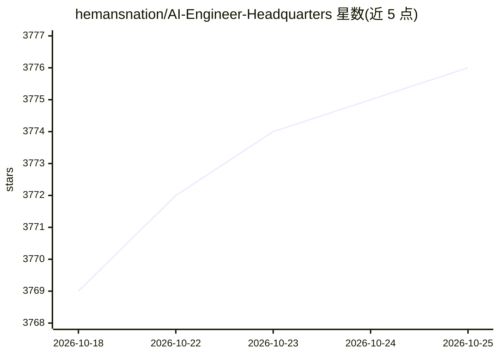

# hemansnation/AI-Engineer-Headquarters

⭐ 3,777 · Jupyter Notebook · 推送 2026-10-14 · [GitHub](https://github.com/hemansnation/AI-Engineer-Headquarters) · [官网](https://www.masterdexter.io/ai-engineer-hq) · 个人维护

**面向数据与 AI 工程师的学习路线与训练资源库**

个人维护的开源学习资源仓库，宣称提供一套以视频课程和文字笔记为载体的 AI 工程师训练路径，覆盖基础工具、机器学习与 MLOps、大语言模型使用、生产级 RAG 系统、微调、自主 AI Agent 构建等阶段主题。内容面向处于领导岗、在职专业人士或学生等不同阶段的学习者，并附带作者自定的每日深度工作/浅层工作学习日程安排。仓库本身不含代码实现或模型，以主题清单和学习方法为主要内容。

## 筛选速览

| 维度 | 判定 | 备注 |
|---|---|---|
| AI 角色 | `ai-knowledge` | 知识聚合/清单类 |
| 许可风险 | `none` | — |
| 部署形态 | `None` |  |
| 模型依赖 | — | README 未给出锁定关系 |
| 硬件要求 | — | 无带数字的原话,不猜 |
| 安装摩擦 | `low` | 无编译、无系统依赖或容器化 |
| 成熟度 | — | 结构信号不足 |

## 能力要点

- 覆盖 ML/MLOps、LLM、RAG、微调、AI Agent 的分阶段学习路径
- 以视频课程与文字笔记两种形式提供内容
- 附带作者定义的每日深度工作学习日程框架

## 适用场景

- 按阶段系统性学习 AI 工程相关主题
- 查找 LLM、RAG、Agent 方向的学习路线参考
- 了解作者推荐的深度工作训练方法

## 场景标签

`教程课程` `精选清单` · 领域:学习与行业

## 证据(README 行号)

> L5: A drill of scientific methods, processes, algorithms, and systems to build stories & models. An in-depth learning re
> L44: 0. Prep

## 星数曲线

2026-10-18 3,769 → 2026-10-25 3,776（+7）

---
*卡片 v1 · prompt 1.4 · 生成 2026-10-20 · 置信度 high · 依据 README sha `73530a4f09b4` · [字段定义](../../DATASET.md)*
