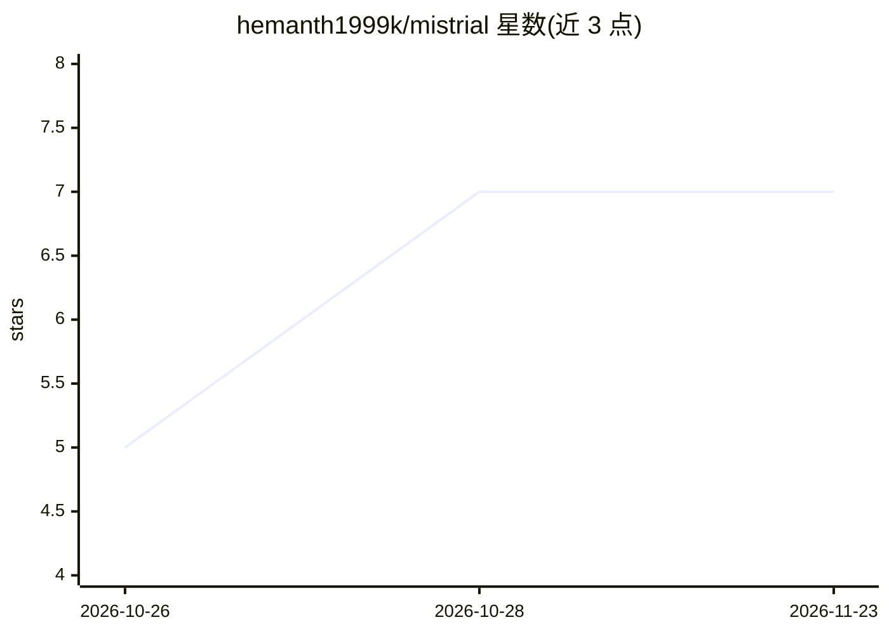

# hemanth1999k/mistrial

⭐ 7 · Python · MIT · 推送 2026-10-27 · [GitHub](https://github.com/hemanth1999k/mistrial) · 个人维护

**检测 LLM-as-a-judge 评估器稳定性的 CLI 工具**

mistrial 是一个 Python CLI 与 GitHub Action，用于测量 LLM 评审器（judge）的可靠性：将用户已有的 evaluator（模型名、LangSmith/openevals 函数）跨多次运行、多个 judge 模型与多种 rubric 措辞重复提问，输出可靠性卡片，包括 self-agreement、翻转案例、Cohen's kappa、Krippendorff's alpha、与人工标签的准确率及解析审计。运行记录存为 JSON 并缓存响应。面向在 CI 中依赖 LLM judge 分数的开发者，提供 CI gate、带相同签名的稳定化 judge 与人工复核清单。MIT 许可，PyPI 安装，含 demo 假 judge 可无 key 运行。

## 筛选速览

| 维度 | 判定 | 备注 |
|---|---|---|
| AI 角色 | `ai-ecosystem` | LLM/agent 周边工具 |
| 许可风险 | `permissive` | MIT |
| 部署形态 | `library` | 以包/库形式分发 |
| 模型依赖 | local-ok | 支持本地模型 |
| 硬件要求 | — | 无带数字的原话,不猜 |
| 安装摩擦 | `low` | 无编译、无系统依赖或容器化 |
| 成熟度 | — | 结构信号不足 |

## 能力要点

- 跨 runs、judge 模型与 rubric 措辞重跑任意 evaluator 并输出可靠性卡片
- 计算 self-agreement、kappa、Krippendorff's alpha、与人工标签准确率
- 提供 CI gate、与原 evaluator 同签名的稳定化 judge（多数投票）
- 支持 JSONL/JSON/CSV 用例文件，运行结果存 JSON 且响应落盘缓存

## 适用场景

- 上线前检测 LLM judge 在重复运行下是否翻转判定
- 在 CI 中为评估分数设置防误报的 gate
- 对比不同 judge 模型之间的一致性并挑选替代
- 排查 rubric 措辞改动导致判定漂移的案例

## 场景标签

`模型评测` · 领域:评测与运维

## 证据(README 行号)

> L41: Point it at the evaluator you already use: a model name, or the function you run in LangSmith or openevals. It asks
> L137: |`module:function`|any Python function with the LangSmith / openevals signature|

## 星数曲线

2026-10-26 5 → 2026-11-23 7（+2）

---
*卡片 v1 · prompt 1.4 · 生成 2026-11-20 · 置信度 high · 依据 README sha `abb706500772` · [字段定义](../../DATASET.md)*
