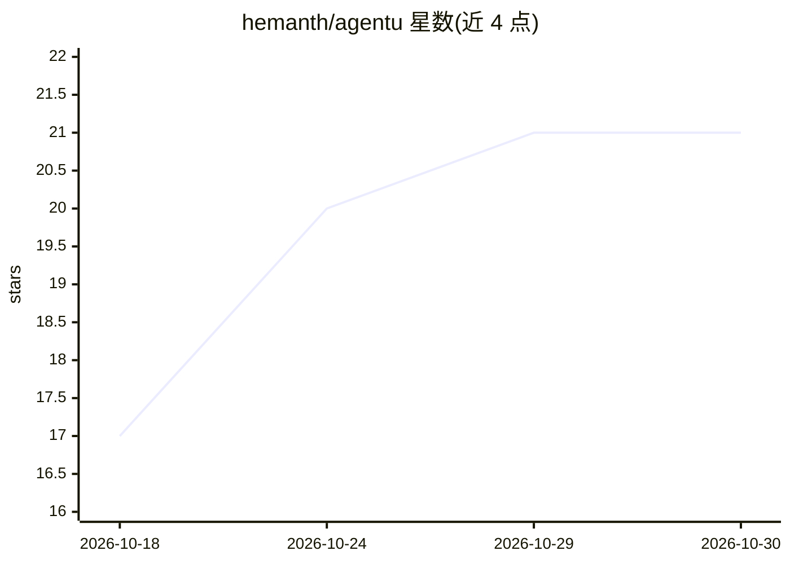

# hemanth/agentu

⭐ 21 · Python · MIT · 推送 2026-10-13 · [GitHub](https://github.com/hemanth/agentu) · [官网](https://hemanth.github.io/agentu-codelab/) · 个人维护

**面向开发者的 Python AI agent 运行时：工具沙箱、自纠错与权限分级**

以 pip 安装的 Python agent 运行时，面向构建 LLM agent 的开发者。提供多轮 agentic 推理循环、子进程隔离的工具沙箱（超时/内存限制/禁网）、输出护栏失败自动回喂重试、结构化输出校验、多模态输入与能力感知降级（视频/音频转 Markdown 文本）、上下文压缩、SQLite 记忆与语义召回、工作流编排（顺序/并行/断点恢复）、YAML/JSON 声明式部署与简单评测。原生 provider 驱动用于不暴露 OpenAI 兼容端点的服务（如 Gemini）。

## 筛选速览

| 维度 | 判定 | 备注 |
|---|---|---|
| AI 角色 | `ai-ecosystem` | LLM/agent 周边工具 |
| 许可风险 | `permissive` | MIT |
| 部署形态 | `library` | 以包/库形式分发 |
| 模型依赖 | local-ok | 支持本地模型 |
| 硬件要求 | — | 无带数字的原话,不猜 |
| 安装摩擦 | `low` | 无编译、无系统依赖或容器化 |
| 成熟度 | — | 结构信号不足 |

## 能力要点

- 工具在子进程中隔离运行，支持超时、内存限制与禁网（READONLY/WRITE 权限分级）
- 护栏与结构化输出校验失败时自动回喂 LLM 自纠错重试
- Code Mode：LLM 编写 Python 代码串联工具调用，错误自动重试
- 多模态能力感知降级：文本模型自动将视频/音频转 Markdown 转录

## 适用场景

- 构建带工具沙箱与权限控制的多轮 LLM agent
- 用 YAML/JSON 声明式配置零代码部署 agent
- 长任务 agent 的上下文压缩与断点恢复工作流
- 对 agent 输出做护栏校验与简单断言评测

## 场景标签

`Agent 框架` · 领域:Agent 开发

## 证据(README 行号)

> L3: A harness-engineered AI agent runtime. Build agents with tool isolation, self-correction, and permission scoping out
> L18: `call()` runs a tool. `infer()` runs a multi-turn agentic loop — the LLM picks tools, calls them, sees results, and

## 星数曲线

2026-10-18 17 → 2026-10-30 21（+4）

---
*卡片 v1 · prompt 1.4 · 生成 2026-10-28 · 置信度 high · 依据 README sha `6137edc5af75` · [字段定义](../../DATASET.md)*
