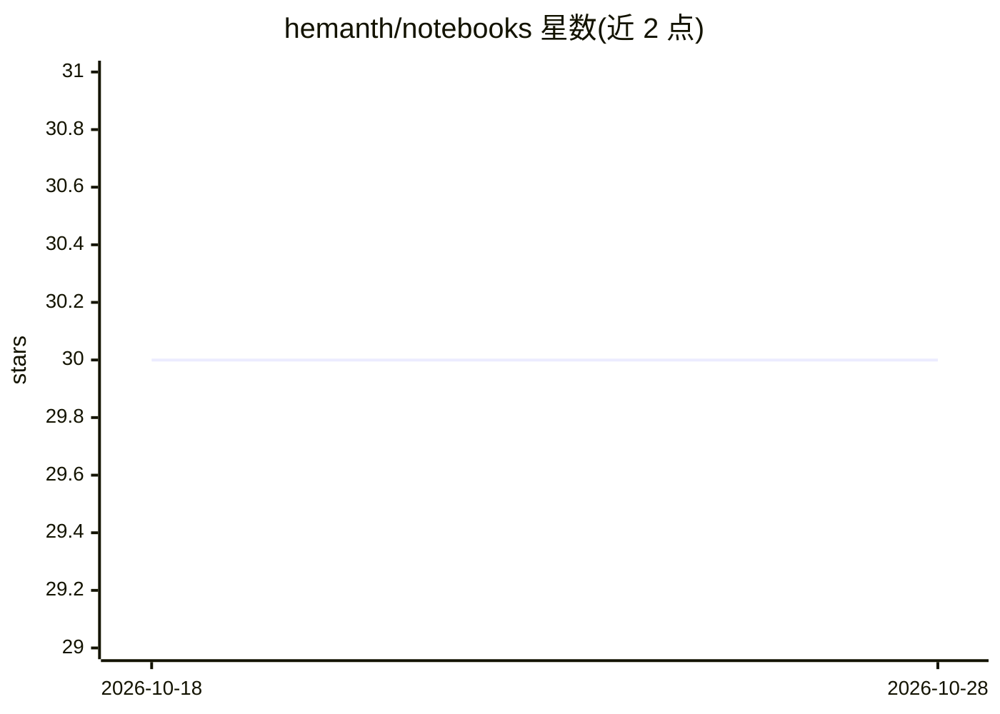

# hemanth/notebooks

⭐ 30 · Jupyter Notebook · MIT · 推送 2026-04-03 · [GitHub](https://github.com/hemanth/notebooks) · 个人维护

**ML/AI 实验 Jupyter notebook 个人合集（LLM、RAG、agent 等）**

个人维护的机器学习与 AI 实验 notebook 仓库，按主题分组列出条目：Google Gemini 与 Gemma 系列模型实验、RAG 与检索（含 Langchain/LlamaIndex/Ollama 搭配）、AI agent 工作流（CrewAI、smolagents）、推理与自我精炼、BitNet/GaLore 等专用模型，以及 TTS、简历转 JSON、背景移除等工具类实验。README 仅含目录式条目清单，不含安装命令或运行说明，需逐个 notebook 自行查看与运行。

## 筛选速览

| 维度 | 判定 | 备注 |
|---|---|---|
| AI 角色 | `ai-knowledge` | 知识聚合/清单类 |
| 许可风险 | `permissive` | MIT |
| 部署形态 | `None` |  |
| 模型依赖 | local-ok | 支持本地模型 |
| 硬件要求 | — | 无带数字的原话,不猜 |
| 安装摩擦 | `low` | 无编译、无系统依赖或容器化 |
| 成熟度 | — | 结构信号不足 |

## 能力要点

- 覆盖 Gemini/Gemma 系列、RAG、agent、推理与 TTS 等多类实验
- 条目按 10 个主题分组组织
- 多数实验搭配 Langchain/LlamaIndex/Ollama 等工具

## 适用场景

- 查找特定模型或框架（如 Gemini、Ollama、CrewAI）的上手示例代码
- 参考 RAG、agent 工作流的实验写法
- 浏览个人 ML/AI 实验的实践模式

## 场景标签

`精选清单` · 领域:学习与行业

## 证据(README 行号)

> L1: # notebooks
> L2: > Notebooks on ML AI experiments

## 星数曲线

2026-10-18 30 → 2026-10-28 30（+0）

---
*卡片 v1 · prompt 1.4 · 生成 2026-10-26 · 置信度 high · 依据 README sha `ab73644bf4ca` · [字段定义](../../DATASET.md)*
