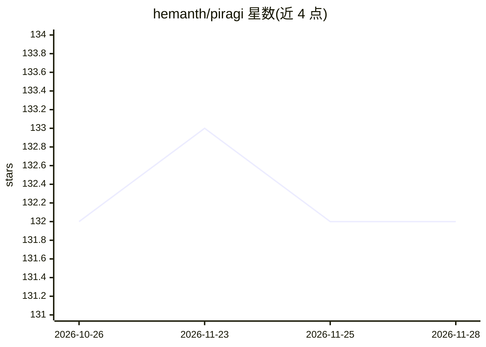

# hemanth/piragi

⭐ 132 · Python · MIT · 推送 2026-11-03 · [GitHub](https://github.com/hemanth/piragi) · [官网](https://hemanth.github.io/piragi/) · 个人维护

**本地优先的 Python RAG 接口库：读取多源文档并生成带引用的回答**

Python 库形式的 RAG 接口，内置向量存储、嵌入与引用生成，默认本地运行。支持读取本地文件、S3/GCS/Azure/HDFS/SFTP 远程存储（glob 模式）与递归网页抓取；文档格式覆盖 PDF、Word、Excel、Markdown、代码、图片、音频。检索侧提供 HyDE、混合搜索、重排序、语义分块、知识图谱抽取，可插拔后端包括 LanceDB、PostgreSQL、Pinecone、Supabase。提供异步 API、独立检索模式、RED/USE 指标与分布式追踪，可通过 pip 安装并附带 playground。声明其基准成绩来自 AIR-Bench 与 BRIGHT。

## 筛选速览

| 维度 | 判定 | 备注 |
|---|---|---|
| AI 角色 | `ai-ecosystem` | LLM/agent 周边工具 |
| 许可风险 | `permissive` | MIT |
| 部署形态 | `library` | 以包/库形式分发 |
| 模型依赖 | local-ok | 支持本地模型 |
| 硬件要求 | — | 无带数字的原话,不猜 |
| 安装摩擦 | `low` | 无编译、无系统依赖或容器化 |
| 成熟度 | — | 结构信号不足 |

## 能力要点

- 内置向量存储、嵌入、引用与后台自动更新，默认本地免费运行
- 多源读取：本地目录、S3/GCS/Azure/HDFS/SFTP glob 模式、递归网页抓取
- 可插拔向量存储后端（LanceDB/PostgreSQL/Pinecone/Supabase）与 HyDE/混合搜索/重排序
- 内置 RED/USE 指标、W3C 追踪、结构化 JSON 日志，零配置

## 适用场景

- 对本地或云端文档库做检索增强问答并附带来源引用
- 把 S3 等对象存储中的文档接入知识库并后台自动刷新
- 在异步 Web 框架中以非阻塞方式集成 RAG 能力
- 仅用 retrieve() 做纯检索层而不接 LLM

## 场景标签

`RAG` · 领域:知识与检索

## 证据(README 行号)

> L6: from piragi import Ragi
> L8: kb = Ragi(["./docs", "s3://bucket/data/**/*.pdf", "https://api.example.com/docs"])
> L9: answer = kb.ask("How do I deploy this?")

## 星数曲线

2026-10-26 132 → 2026-11-28 132（+0）

---
*卡片 v1 · prompt 1.4 · 生成 2026-11-28 · 置信度 high · 依据 README sha `0fcbdf7e914b` · [字段定义](../../DATASET.md)*
