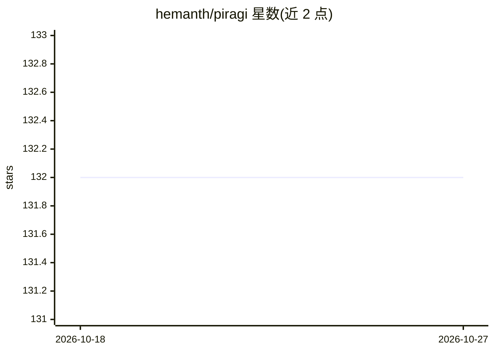

# hemanth/piragi

⭐ 132 · Python · MIT · 推送 2026-08-26 · [GitHub](https://github.com/hemanth/piragi) · [官网](https://hemanth.github.io/piragi/) · 个人维护

**面向开发者的本地优先 RAG Python 库：一行构建可问答知识库**

以 Ragi 类为核心的 RAG 库：传入本地目录、S3/GCS/Azure/HDFS/SFTP 远程路径或网站 URL（支持 /** 递归爬取）即自动完成摄取、切块、索引与问答。内置向量存储、embeddings、引用来源与后台自动更新，默认使用免费本地模型、零配置。支持可插拔向量后端（LanceDB/PostgreSQL/Pinecone/Supabase）、HyDE 与混合检索、知识图谱抽取、异步 API，也可仅作检索层使用（无 LLM）。通过 pip 安装，MIT 许可。

## 筛选速览

| 维度 | 判定 | 备注 |
|---|---|---|
| AI 角色 | `ai-ecosystem` | LLM/agent 周边工具 |
| 许可风险 | `permissive` | MIT |
| 部署形态 | `library` | 以包/库形式分发 |
| 模型依赖 | local-ok | 支持本地模型 |
| 硬件要求 | — | 无带数字的原话,不猜 |
| 安装摩擦 | `low` | 无编译、无系统依赖或容器化 |
| 成熟度 | — | 结构信号不足 |

## 能力要点

- 多格式摄入（PDF/Word/Excel/Markdown/代码/URL/图片/音频）与 S3/GCS/Azure/HDFS/SFTP 远程 glob 读取
- 内置向量库、引用来源、后台自动更新，默认免费本地模型零配置
- 可插拔向量后端与 HyDE/混合检索/交叉编码器重排
- AsyncRagi 异步 API 与独立 LLMClient 统一客户端

## 适用场景

- 给本地文档目录或云端存储快速搭建带引用的知识库问答
- 作为无 LLM 的检索层嵌入自己的应用
- 爬取文档站点建立自动更新的问答知识库

## 场景标签

`RAG` `语义搜索` · 领域:知识与检索

## 证据(README 行号)

> L12: Built-in vector store, embeddings, citations, and auto-updates. Free & local by default.
> L141: Use piragi as a retrieval layer without LLM:

## 星数曲线

2026-10-18 132 → 2026-10-27 132（+0）

---
*卡片 v1 · prompt 1.4 · 生成 2026-10-22 · 置信度 high · 依据 README sha `bef6fe19f730` · [字段定义](../../DATASET.md)*
