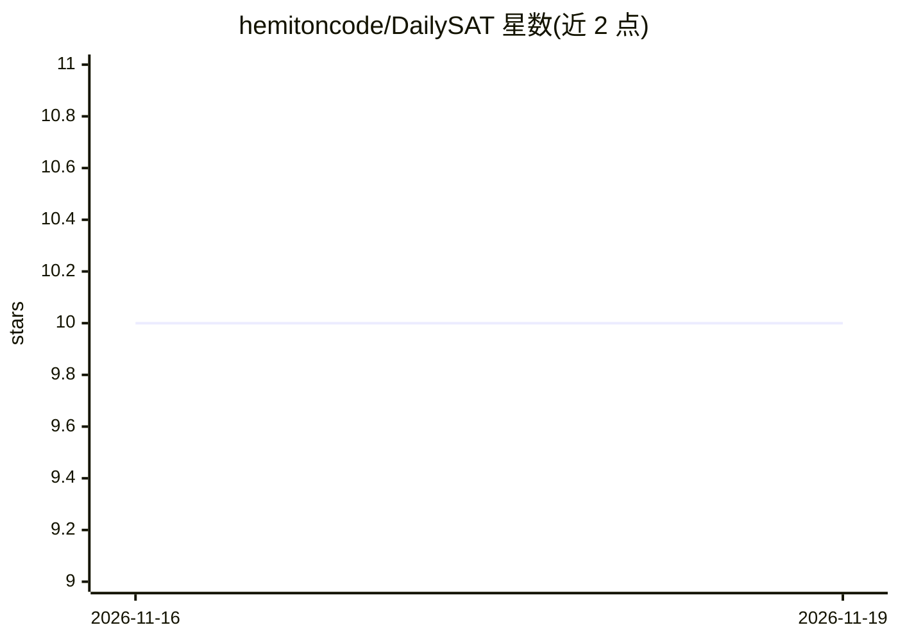

# hemitoncode/DailySAT

⭐ 10 · TypeScript · 推送 2026-10-11 · [GitHub](https://github.com/hemitoncode/DailySAT) · [官网](https://dailysat.tech) · 组织维护

**免费 SAT 备考平台：练习题、AI 学习计划与进度追踪**

面向 SAT 备考学生的 Web 平台，提供数学与英语两类练习题（含详解）、基于 Groq SDK 的 AI 学习计划（根据当前分数、目标分数与考试日期生成路线图）、游戏化机制（金币、连胜、头像商店、排行榜）与推荐系统。技术栈为 Next.js 15 + MongoDB + Redis，采用 Better Auth 与 Google OAuth 认证，支持 Docker 运行 MongoDB 的本地部署流程，仅提供源码运行方式。

## 筛选速览

| 维度 | 判定 | 备注 |
|---|---|---|
| AI 角色 | `ai-enhanced` | 去掉 AI 部分产品仍成立 |
| 许可风险 | `none` | — |
| 部署形态 | `self-host` | docker 或自建部署 |
| 模型依赖 | locked-api |  |
| 硬件要求 | — | 无带数字的原话,不猜 |
| 安装摩擦 | `low` | 无编译、无系统依赖或容器化 |
| 成熟度 | — | 结构信号不足 |

## 能力要点

- AI 学习计划器按当前/目标分数与考试日期生成学习路线
- 数学与英语各 4 个 SAT 类别练习题与详解
- 金币、连胜、头像商店与排行榜的游戏化机制
- Next.js + MongoDB + Redis 全栈本地部署文档

## 适用场景

- SAT 考生按目标分数生成个性化学习计划
- 练习数学与英语题目并追踪正确率
- 通过连胜与排行榜激励每日坚持备考

## 场景标签

 · 领域:教育/考试备考

## 证据(README 行号)

> L5:  Your AI-Powered SAT Preparation Platform
> L21: |🤖 **AI Study Planner**|Personalized study plans powered by Groq SDK based on your target score|
> L24: |📊 **Progress Tracking**|Visual statistics and analytics of your performance|

## 星数曲线

2026-11-16 10 → 2026-11-19 10（+0）

---
*卡片 v1 · prompt 1.4 · 生成 2026-11-19 · 置信度 high · 依据 README sha `5bd21edd19bc` · [字段定义](../../DATASET.md)*
