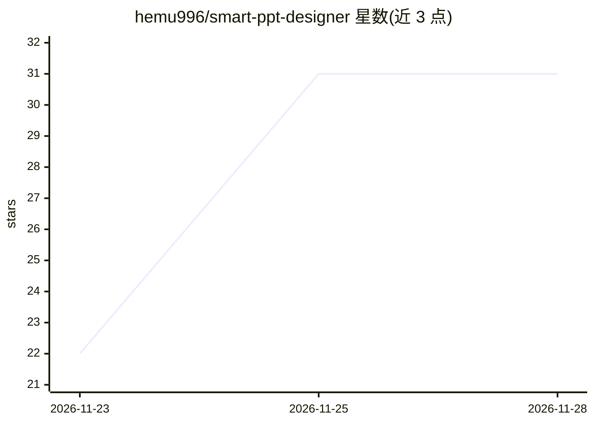

# hemu996/smart-ppt-designer

⭐ 31 · Python · MIT · 推送 2026-11-26 · [GitHub](https://github.com/hemu996/smart-ppt-designer) · 个人维护 · 中文 README

**把 PDF/DOCX 材料生成原生可编辑 PPT 的技能包**

面向需要把已有材料快速做成演示稿的用户（README 以国赛参赛场景为例）的技能包：读取 PDF/DOCX/旧 PPT/参考图，输出 PowerPoint 原生对象（形状/表格/图表/备注）构成的演示稿。核心机制包括按内容检索 19 套视觉系统、29 条红线脚本校验、13 步工作流、静态排版检测与自评分低于阈值时自动回写重排。需 Python 3.9+ 与 Node.js 16+，PowerPoint 仅可选用于真开验证；README 自述设计师级细节仍需人工终审。

## 筛选速览

| 维度 | 判定 | 备注 |
|---|---|---|
| AI 角色 | `ai-native` | 本体是模型或模型工具 |
| 许可风险 | `permissive` | MIT |
| 部署形态 | `library` | 以包/库形式分发 |
| 模型依赖 | — | README 未给出锁定关系 |
| 硬件要求 | — | 无带数字的原话,不猜 |
| 安装摩擦 | `low` | 无编译、无系统依赖或容器化 |
| 成熟度 | — | 结构信号不足 |

## 能力要点

- 产物为 PowerPoint 原生对象，双击即可编辑
- 19 套视觉系统按内容检索匹配，不设默认模板
- 29 条红线由脚本校验，不合格阻断出稿
- 静态排版检测输出结构化 JSON+Markdown 报告，自评分低于 75 分自动重排

## 适用场景

- 把比赛材料快速整理成可讲可改的参赛演示稿
- 从旧 PPT/参考稿中提取风格并复用到新主题
- 对生成的 PPT 做溢出、遮挡等排版问题自动检查

## 场景标签

`文档解析` · 领域:知识与检索

## 证据(README 行号)

> L3: > 把「材料」变成「能讲的国赛级 PPT」的技能包：原生可编辑、视觉体系统一、风格按内容检索而非套模板。
> L7: **一句话：你给 PDF / DOCX / 旧 PPT / 参考图，它产出一份评委愿意看完、每个字都能在 PowerPoint 里直接改的演示稿——不做图片拼贴、不套固定模板、封面自动用 AI 书法烫金。**
> L125: - **Python 3.9+**：脚本主语言

## 星数曲线

2026-11-23 22 → 2026-11-28 31（+9）

---
*卡片 v1 · prompt 1.4 · 生成 2026-11-23 · 置信度 high · 依据 README sha `bedd8859634e` · [字段定义](../../DATASET.md)*
