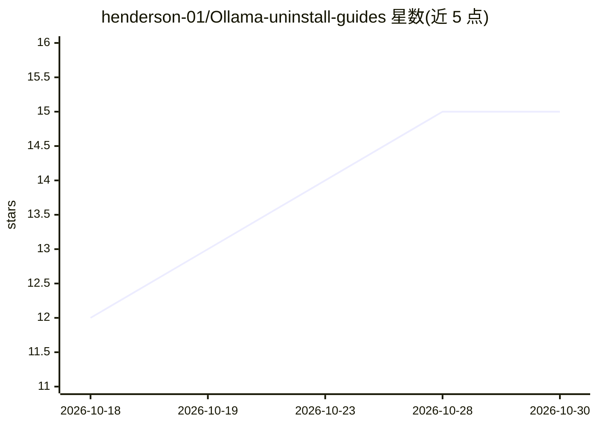

# henderson-01/Ollama-uninstall-guides

⭐ 15 · Shell · MIT · 推送 2026-08-10 · [GitHub](https://github.com/henderson-01/Ollama-uninstall-guides) · 个人维护

**Ollama 卸载指南与脚本：覆盖 macOS/Windows/Linux 清理**

面向通过官方下载或 curl 脚本安装 Ollama 的用户，提供三个平台的逆向整理手动卸载命令，说明各平台安装脚本的落盘位置（应用、符号链接、systemd 服务、专用用户、模型目录 ~/.ollama 等），并附带可交互的自动化卸载脚本（uninstall-mac.sh / uninstall-windows.ps1 / uninstall-linux.sh），运行时会询问是否保留模型数据。通过包管理器（Homebrew/Winget/Chocolatey/Docker）安装的用户被引导使用各自包管理器的卸载命令。仓库以 MIT 许可发布，声明按现状提供、风险自负。

## 筛选速览

| 维度 | 判定 | 备注 |
|---|---|---|
| AI 角色 | `ai-knowledge` | 知识聚合/清单类 |
| 许可风险 | `permissive` | MIT |
| 部署形态 | `desktop` | 安装包/桌面程序 |
| 模型依赖 | — | README 未给出锁定关系 |
| 硬件要求 | — | 无带数字的原话,不猜 |
| 安装摩擦 | `low` | 无编译、无系统依赖或容器化 |
| 成熟度 | — | 结构信号不足 |

## 能力要点

- macOS/Windows/Linux 三平台手动卸载命令
- 附带 .sh 与 .ps1 自动化一键卸载脚本，交互式询问是否保留模型
- 各平台卸载后验证命令（检查残留命令与模型权重）
- 说明官方安装脚本在各地的落盘细节（/usr/local/bin、systemd 服务、/usr/share/ollama 等）

## 适用场景

- 彻底卸载 Ollama 并清理残留的模型权重
- 干净重装 Ollama 前做完整清理
- 了解官方安装脚本在各系统上的实际改动位置

## 场景标签

 · 领域:LLM 工具/系统运维

## 证据(README 行号)

> L1: # 🤖 The Ollama Uninstall Guide macOS/Windows/Linux
> L7: Below, you will find the accurate, reverse-engineered manual teardown commands for macOS, Windows, and Linux. **I ha

## 星数曲线

2026-10-18 12 → 2026-10-30 15（+3）

---
*卡片 v1 · prompt 1.4 · 生成 2026-10-30 · 置信度 high · 依据 README sha `0f3170104f1d` · [字段定义](../../DATASET.md)*
