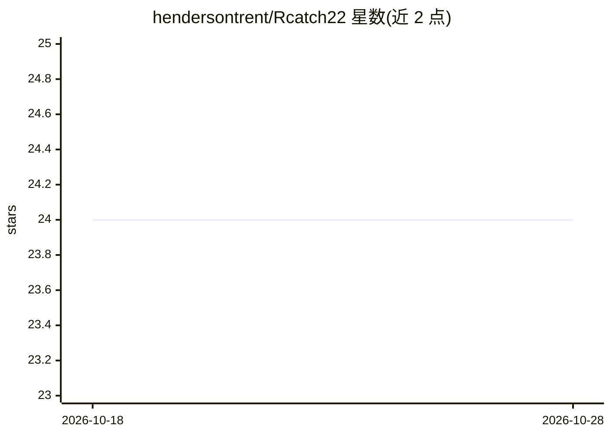

# hendersontrent/Rcatch22

⭐ 24 · C · 推送 2026-10-27 · [GitHub](https://github.com/hendersontrent/Rcatch22) · 个人维护

**计算 22 个时间序列规范特征的 R 包**

Rcatch22 是一个 R 包，提供对 catch22 这套 22 个时间序列规范特征（CAnonical Time-series CHaracteristics）的计算实现，底层特征计算以 C 代码实现，计算时间随序列长度近线性扩展。可通过 CRAN 安装稳定版或从 GitHub 安装开发版，支持将 catch24 参数设为 TRUE 以额外加入均值和标准差两个特征。README 提及配套 R 包 theft 可统一访问包括 Rcatch22 在内的多套特征（R 与 Python 共逾 6,600 个特征），并提供引用信息与原始 catch22 论文链接。

## 筛选速览

| 维度 | 判定 | 备注 |
|---|---|---|
| AI 角色 | `ai-native` | 本体是模型或模型工具 |
| 许可风险 | `none` | — |
| 部署形态 | `None` |  |
| 模型依赖 | — | README 未给出锁定关系 |
| 硬件要求 | — | 无带数字的原话,不猜 |
| 安装摩擦 | `low` | 无编译、无系统依赖或容器化 |
| 成熟度 | — | 结构信号不足 |

## 能力要点

- 计算 catch22 的 22 个时间序列特征
- 特征以 C 代码实现，计算时间近线性扩展
- catch24 选项可额外加入均值与标准差特征

## 适用场景

- 为时间序列分类/聚类任务提取特征
- 在 R 中批量计算时间序列的规范特征集
- 科研分析中按论文引用规范使用 catch22 特征

## 场景标签

 · 领域:时间序列分析/机器学习

## 证据(README 行号)

> L9: R package for the calculation of [22 CAnonical Time-series
> L11: The package is an efficient implementation that calculates time-series

## 星数曲线

2026-10-18 24 → 2026-10-28 24（+0）

---
*卡片 v1 · prompt 1.4 · 生成 2026-10-27 · 置信度 high · 依据 README sha `671ec672870a` · [字段定义](../../DATASET.md)*
