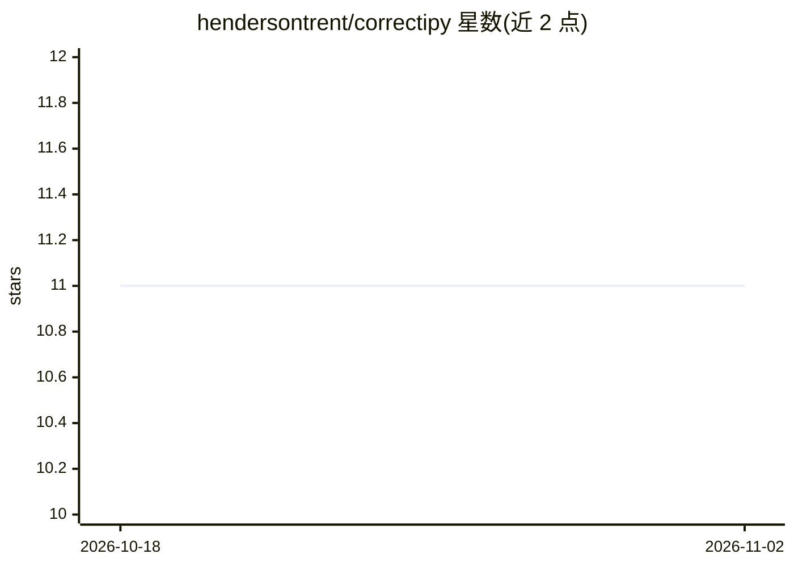

# hendersontrent/correctipy

⭐ 11 · Python · MIT · 推送 2026-06-24 · [GitHub](https://github.com/hendersontrent/correctipy) · [官网](http://correctipy.readthedocs.io/) · 个人维护

**对相关样本上两个ML模型比较的校正统计检验Python库**

Python 库，实现 Nadeau and Bengio (2003) 提出的校正检验统计量，用于数据重采样、k 折交叉验证与重复 k 折交叉验证下两个机器学习模型性能指标（如分类准确率）的比较，解决传统 t 检验低估方差、I 类错误偏高的问题。提供 resampled_ttest、kfold_ttest、repkfold_ttest 三个单行调用函数，返回含 statistic 与 p_value 的 Pandas DataFrame，支持单尾/双尾检验。限制：当前仅支持两个模型比较。另有 R 语言版本 correctR。通过 GitHub pip 安装。

## 筛选速览

| 维度 | 判定 | 备注 |
|---|---|---|
| AI 角色 | `ai-ecosystem` | LLM/agent 周边工具 |
| 许可风险 | `permissive` | MIT |
| 部署形态 | `library` | 以包/库形式分发 |
| 模型依赖 | — | README 未给出锁定关系 |
| 硬件要求 | — | 无带数字的原话,不猜 |
| 安装摩擦 | `low` | 无编译、无系统依赖或容器化 |
| 成熟度 | — | 结构信号不足 |

## 能力要点

- 三种校正检验：随机子采样、k 折、重复 k 折交叉验证
- 函数返回 statistic 与 p_value 两列的 Pandas DataFrame，可嵌入流水线
- 支持单尾/双尾检验（tailed 与 greater 参数）

## 适用场景

- 论文或报告中验证两个模型性能差异是否统计显著
- k 折交叉验证结果的传统 t 检验因样本相关而不可靠时做校正
- 自动化机器学习流水线中嵌入显著性检验输出

## 场景标签

`模型评测` · 领域:评测与运维

## 证据(README 行号)

> L28: Type I error. `correctipy` is a lightweight package that implements a
> L41: `correctipy` is a lightweight package that implements a small number of corrected test statistics for cases when sa
> L100: All the functions return a Pandas dataframe with two named columns: `"statistic"` (the $t$-statistic) and `"p_valu

## 星数曲线

2026-10-18 11 → 2026-11-02 11（+0）

---
*卡片 v1 · prompt 1.4 · 生成 2026-11-02 · 置信度 high · 依据 README sha `c5792cb22086` · [字段定义](../../DATASET.md)*
