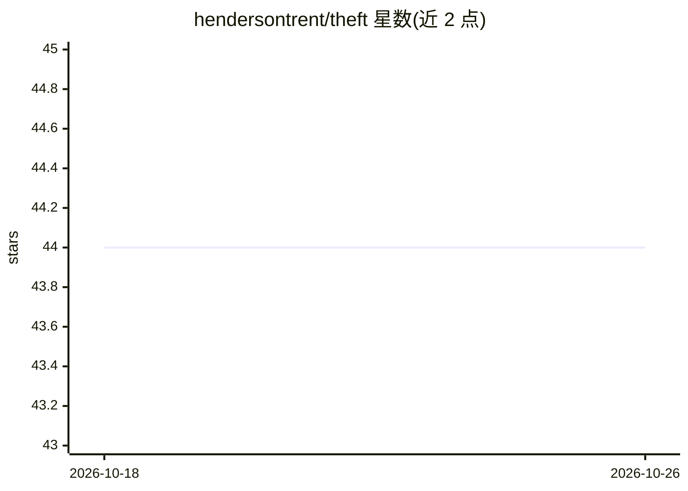

# hendersontrent/theft

⭐ 44 · R · NOASSERTION · 推送 2026-06-09 · [GitHub](https://github.com/hendersontrent/theft) · [官网](https://hendersontrent.github.io/theft/) · 个人维护

**R 包：统一接口从时序数据提取约 6000 个特征**

面向 R 用户的时序特征提取工具包：通过单一一致接口访问来自 7 个 R/Python 包（catch22、feasts、tsfeatures、Kats、tsfresh、TSFEL、hctsa）的约 6000 个时序特征，并支持用户自定义特征与四个基线特征集（FFT 系数、分位数、矩）。Python 特征集需本机安装 Python（建议 ≥3.10），包内提供安装辅助函数。特征的分析、可视化与时序分类由姊妹包 theftdlc 承担，两者组成 'theft 生态系统'。可从 CRAN 或 GitHub 安装。

## 筛选速览

| 维度 | 判定 | 备注 |
|---|---|---|
| AI 角色 | `ai-ecosystem` | LLM/agent 周边工具 |
| 许可风险 | `none` | NOASSERTION |
| 部署形态 | `None` |  |
| 模型依赖 | — | README 未给出锁定关系 |
| 硬件要求 | — | 无带数字的原话,不猜 |
| 安装摩擦 | `low` | 无编译、无系统依赖或容器化 |
| 成熟度 | — | 结构信号不足 |

## 能力要点

- 统一接口聚合 7 个 R/Python 特征包约 6000 个特征
- 支持用户自定义特征与 4 个基线特征集（fft/quantiles/fftquantiles/moments）
- 内置安装 Python 依赖的辅助函数（install_python_pkgs）
- 与 theftdlc 配套完成特征投影、分类与统计比较

## 适用场景

- 为时序分类/建模任务批量计算特征
- 在同一框架下对比不同特征集的性能
- 按 tidyverts 工作流做时序特征分析

## 场景标签

 · 领域:时间序列分析/特征工程

## 证据(README 行号)

> L36: `theft` is a software package for R that facilitates user-friendly
> L38: features. The package provides a single point of access to
> L39: $\approx 6000$ time-series features from a range of existing R and

## 星数曲线

2026-10-18 44 → 2026-10-26 44（+0）

---
*卡片 v1 · prompt 1.4 · 生成 2026-10-25 · 置信度 high · 依据 README sha `5339ab33b689` · [字段定义](../../DATASET.md)*
