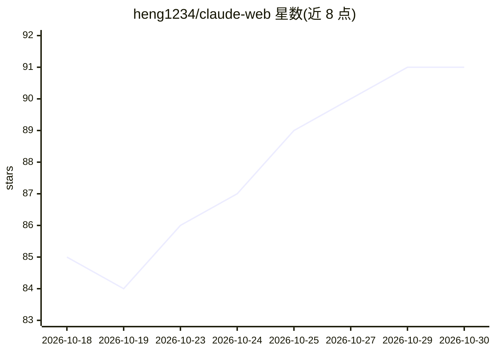

# heng1234/claude-web

⭐ 91 · HTML · Apache-2.0 · 推送 2026-10-18 · [GitHub](https://github.com/heng1234/claude-web) · 个人维护 · 中文 README

**Claude Code CLI 的本地 Web 界面，支持多会话与工具可视化**

Claude Code 的本地 GUI 包装器：Code 模式经 Claude Agent SDK 原生持久会话（Node bridge），普通聊天沿用 claude CLI 路径，通过 SSE 展示回答、工具执行、思考状态与文件改动。功能覆盖图片/文档输入、代码工作区（Git 分支、Project Map、Worktrees、checkpoint 回滚、Agent Loop）、MCP 连接器目录（密钥本机加密）、会话管理与导入 CLI 历史、Chrome MV3 侧栏插件。需 Python 3.9+（Code 模式需 Node.js 18+）与已有 Claude Code 登录凭据；数据存本机，不接触 Anthropic API Key。

## 筛选速览

| 维度 | 判定 | 备注 |
|---|---|---|
| AI 角色 | `ai-ecosystem` | LLM/agent 周边工具 |
| 许可风险 | `permissive` | Apache-2.0 |
| 部署形态 | `library` | 以包/库形式分发 |
| 模型依赖 | locked-api |  |
| 硬件要求 | — | 无带数字的原话,不猜 |
| 安装摩擦 | `low` | 无编译、无系统依赖或容器化 |
| 成熟度 | — | 结构信号不足 |

## 能力要点

- Code 模式使用 Claude Agent SDK 原生持久会话，普通聊天走 claude CLI 路径
- 代码工作区含 Git checkpoint 回滚、Project Map、Worktrees、Agent Loop 预算控制
- 内置分类 MCP 连接器目录，密钥用本机主密钥加密存储
- Chrome MV3 Side Panel 插件可读取当前页并转入完整会话

## 适用场景

- 在浏览器或手机上使用本机 Claude Code 会话
- 代码开发中查看工具执行进度、文件 diff 并做 checkpoint 回滚
- 导入并继续 ~/.claude/projects/ 中的 CLI 历史会话
- 通过 MCP 连接器接入 GitHub、Notion、Sentry 等服务

## 场景标签

`编码 Agent` `聊天机器人` · 领域:编码与开发

## 证据(README 行号)

> L8: Claude Code Web 2.0 是 Claude Code 的本地 Web 界面。Code 模式使用 Claude Agent SDK 原生持久会话，普通聊天保留 `claude` CLI 路径；两种 runtime 有严格
> L15: > 🔒 **隐私说明**：本工具只是 `claude` CLI 的本地 GUI 包装器，不上传任何数据到第三方服务。所有对话、图片、会话历史都存在本机 `history/` `uploads/` `claude-web.db` 中
> L125: 1. Python 3.9+

## 星数曲线

2026-10-18 85 → 2026-10-30 91（+6）

---
*卡片 v1 · prompt 1.4 · 生成 2026-10-23 · 置信度 mid · 依据 README sha `060ebe7c1dce` · [字段定义](../../DATASET.md)*
