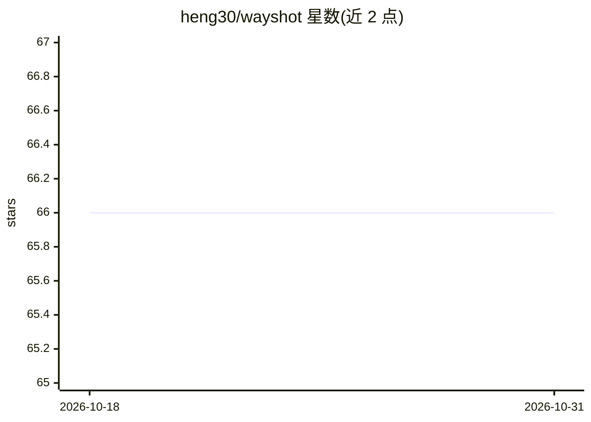

# heng30/wayshot

⭐ 66 · Rust · Apache-2.0 · 推送 2026-10-30 · [GitHub](https://github.com/heng30/wayshot) · 个人维护 · 中文 README

**带大量 AI 辅助功能的视频编辑、录屏、推流与屏幕共享桌面工具**

用 Rust 与 Slint GUI 框架构建的桌面视频创作工具，支持 Linux 与 Windows。核心功能分四块：视频编辑（多轨时间线、46 种视频滤镜、12 种音频滤镜、关键帧动画、字幕编辑、导出 MP4/音频/字幕）、录屏（光标跟踪、降噪、摄像头采集）、WebRTC 屏幕共享与 RTMP 推流。AI 部分：智能剪辑/混剪、FunASR 转录、字幕翻译与去除、抠像去水印、超分、人声分离、TTS、MusicGen 配乐等十余种工具，另提供暴露 50+ 编辑操作的 MCP Server。需从源码构建，Windows 需配置 LLVM、FFmpeg、Qt6 等依赖。

## 筛选速览

| 维度 | 判定 | 备注 |
|---|---|---|
| AI 角色 | `ai-enhanced` | 去掉 AI 部分产品仍成立 |
| 许可风险 | `permissive` | Apache-2.0 |
| 部署形态 | `None` |  |
| 模型依赖 | — | README 未给出锁定关系 |
| 硬件要求 | — | 无带数字的原话,不猜 |
| 安装摩擦 | `medium` | 含编译或系统依赖之一 |
| 成熟度 | `idea` | |

## 能力要点

- 多轨时间线编辑：46 种视频滤镜、12 种音频滤镜、关键帧动画、SRT/VTT/ASS 字幕导出
- 十余种 AI 工具：转录、字幕翻译/去除、抠像、超分（SwinIR）、人声分离、TTS、MusicGen 配乐
- 录屏（降噪、摄像头背景去除）+ WebRTC 屏幕共享 + RTMP 推流
- MCP Server 暴露 50+ 编辑操作供 AI agent 控制（自述效果欠佳、尚不完整）

## 适用场景

- 在 Linux/Windows 桌面上录制屏幕并直接剪辑成片
- 用 AI 去字幕、去水印、抠像、分离人声后制作视频
- 通过 RTMP 推流或 WebRTC 进行屏幕共享直播

## 场景标签

`图像视频处理` `语音识别` `语音合成` · 领域:内容生成

## 证据(README 行号)

> L15: This is a **video editing**, **screen recording**, **streaming**, and **screen sharing** tool. Built with `Rust` an
> L97: #### AI Tools

## 星数曲线

2026-10-18 66 → 2026-10-31 66（+0）

---
*卡片 v1 · prompt 1.4 · 生成 2026-10-24 · 置信度 high · 依据 README sha `050eca5c89a9` · [字段定义](../../DATASET.md)*
