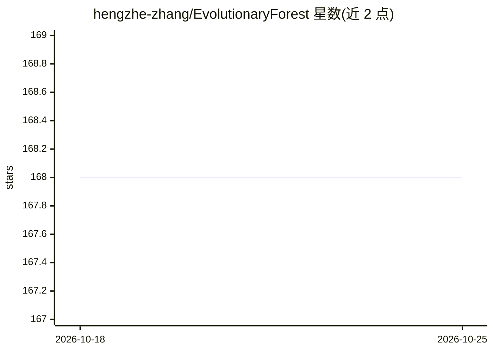

# hengzhe-zhang/EvolutionaryForest

⭐ 168 · Python · LGPL-3.0 · 推送 2026-06-10 · [GitHub](https://github.com/hengzhe-zhang/EvolutionaryForest) · 个人维护 · 中文 README

**基于遗传编程的自动特征工程 Python 库**

开源 Python 库，用遗传编程（GP）自动构造可解释的机器学习特征，并可结合决策树等算法直接用于回归任务。实现 Evolutionary Forest（TEVC 2021）、SR-Forest、SHM-GP、MMTGP、RAG-SR（ICLR 2025）等多个算法，提供 scikit-learn 风格的回归器接口，附论文引用与中英文教程。安装途径为 PyPI 或 GitHub 源码。

## 筛选速览

| 维度 | 判定 | 备注 |
|---|---|---|
| AI 角色 | `ai-native` | 本体是模型或模型工具 |
| 许可风险 | `viral` | LGPL-3.0 |
| 部署形态 | `library` | 以包/库形式分发 |
| 模型依赖 | — | README 未给出锁定关系 |
| 硬件要求 | — | 无带数字的原话,不猜 |
| 安装摩擦 | `low` | 无编译、无系统依赖或容器化 |
| 成熟度 | — | 结构信号不足 |

## 能力要点

- 基于遗传编程的自动特征构造，产出可解释特征
- 收录 5 种算法变体（TEVC 2021-2024、ICLR 2025）
- scikit-learn 风格 API，可直接作为回归模型使用

## 适用场景

- 在小数据集上自动构造特征以提升机器学习模型效果
- 需要可解释特征的传统机器学习流程
- 复现与使用论文中的 GP 特征工程算法

## 场景标签

 · 领域:机器学习/AutoML

## 证据(README 行号)

> L7: An open source Python library for automated feature engineering based on Genetic Programming.
> L20: powerful feature construction tool for enhancing existing state-of-the-art machine learning algorithms, particularl
> L44: - Evolutionary Forest: Ensemble GP for Decision Trees (TEVC 2021)

## 星数曲线

2026-10-18 168 → 2026-10-25 168（+0）

---
*卡片 v1 · prompt 1.4 · 生成 2026-10-22 · 置信度 high · 依据 README sha `cc6b5e62cf85` · [字段定义](../../DATASET.md)*
