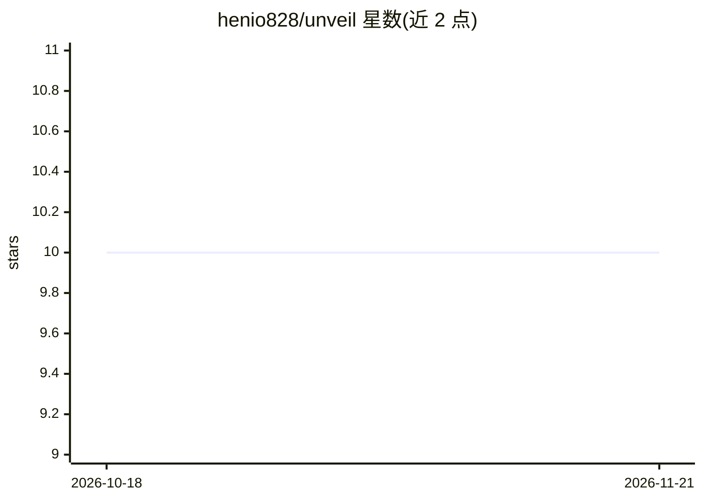

# henio828/unveil

⭐ 10 · Python · MIT · 推送 2026-09-06 · [GitHub](https://github.com/henio828/unveil) · 个人维护

**扫描不可信内容中针对 AI agent 的间接提示注入**

单文件、零依赖的 Python 静态扫描器，检查仓库、issue、PR、网页等不可信内容中为机器而非人类撰写的文本：零宽字符、Unicode tag 字符、双向覆盖、终端转义序列、隐藏的指令覆盖、对人/机内容分叉（honeypot 特征）等 10 条规则，按 high/medium/low 分级输出。提供 --agent-safe 模式以 SHA-256 摘要替代原文，避免报告本身成为注入载体；支持 --json 结构化输出与非零退出码接入 CI。基于模式匹配，自述对新颖措辞、非英语指令、渲染层隐藏手段存在局限。

## 筛选速览

| 维度 | 判定 | 备注 |
|---|---|---|
| AI 角色 | `ai-ecosystem` | LLM/agent 周边工具 |
| 许可风险 | `permissive` | MIT |
| 部署形态 | `None` |  |
| 模型依赖 | — | README 未给出锁定关系 |
| 硬件要求 | — | 无带数字的原话,不猜 |
| 安装摩擦 | `low` | 无编译、无系统依赖或容器化 |
| 成熟度 | — | 结构信号不足 |

## 能力要点

- 10 条检测规则覆盖 Unicode 走私、双向覆盖、隐藏指令与人/机内容分叉
- --agent-safe 输出以摘要替代证据原文，防止报告成为注入载体
- 零依赖单文件，仅用标准库，降低自身供应链风险
- 退出码与 --json 输出可直接用于 CI 门禁

## 适用场景

- 把 issue/PR/README 喂给 coding agent 之前先扫描一遍
- 在 CI 中对不可信输入设置严重度门禁
- 审计仓库中是否存在面向机器的隐藏指令

## 场景标签

`网络安全` `代码审查` · 领域:编码与开发

## 证据(README 行号)

> L5: `unveil` scans untrusted content — repositories, issues, pull requests, docs,
> L9: Zero dependencies. Single file. Standard library only. That is deliberate: a
> L137: - **Pattern-based.** Novel phrasing evades it. It raises the cost of an attack;

## 星数曲线

2026-10-18 10 → 2026-11-21 10（+0）

---
*卡片 v1 · prompt 1.4 · 生成 2026-11-19 · 置信度 mid · 依据 README sha `bf2cc49d68ec` · [字段定义](../../DATASET.md)*
