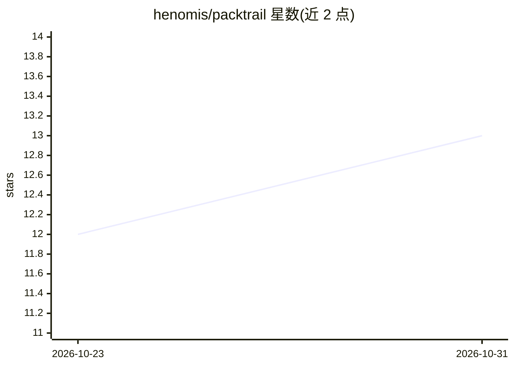

# henomis/packtrail

⭐ 13 · Go · Apache-2.0 · 推送 2026-10-19 · [GitHub](https://github.com/henomis/packtrail) · [官网](https://simonevellei.com/packtrail) · 个人维护

**基于 NATS JetStream 的持久化工作流引擎（Go）**

面向 Go 开发者的 workflow-as-data 引擎：以 YAML 或 Go 结构体声明任务图（任务、分支、fan-out/join、人工等待、子流程、失败补偿路由），引擎解释执行。每次执行是独立 subject 上的有序事件日志，快照、可见性索引、定时任务均由事件派生，支持时间旅行、fork、重放与审计。核心不依赖数据库或额外协调器，仅用 NATS（≥2.12）JetStream 实现；核心无 agent/LLM 概念，agent 即普通 worker，worker 可用任意语言经版本化 JSON 协议接入。提供 Go SDK、CLI 与调试仪表盘。投递为 at-least-once，副作用需幂等或启用结果缓存。

## 筛选速览

| 维度 | 判定 | 备注 |
|---|---|---|
| AI 角色 | `ai-ecosystem` | LLM/agent 周边工具 |
| 许可风险 | `permissive` | Apache-2.0 |
| 部署形态 | `self-host` | docker 或自建部署 |
| 模型依赖 | — | README 未给出锁定关系 |
| 硬件要求 | — | 无带数字的原话,不猜 |
| 安装摩擦 | `low` | 无编译、无系统依赖或容器化 |
| 成熟度 | — | 结构信号不足 |

## 能力要点

- 事件溯源：每次执行为独立 subject 上的事件日志，派生快照/索引/定时器
- 仅依赖 NATS JetStream（≥2.12），无数据库、无额外协调器
- 声明式任务图：fan-out/join、人工等待、子流程、失败补偿、带 reducer 的类型化状态通道
- 任意语言 worker 经版本化 JSON 协议接入；附 Go SDK、CLI 与调试仪表盘

## 适用场景

- 搭建需要可审计、可重放、可时间旅行的持久化工作流
- 编排含人工环节与失败补偿的多步骤业务流程
- 为 agent/tool 循环类任务提供调度与事件日志基础设施

## 场景标签

`工作流自动化` · 领域:效率与自动化

## 证据(README 行号)

> L20: - **Agnostic.** No agents, LLMs or tokens in the core. Budgets are generic
> L21:  counters; an "agent" is just a worker.

## 星数曲线

2026-10-23 12 → 2026-10-31 13（+1）

---
*卡片 v1 · prompt 1.4 · 生成 2026-10-31 · 置信度 low · 依据 README sha `dec112bb06a8` · [字段定义](../../DATASET.md)*
