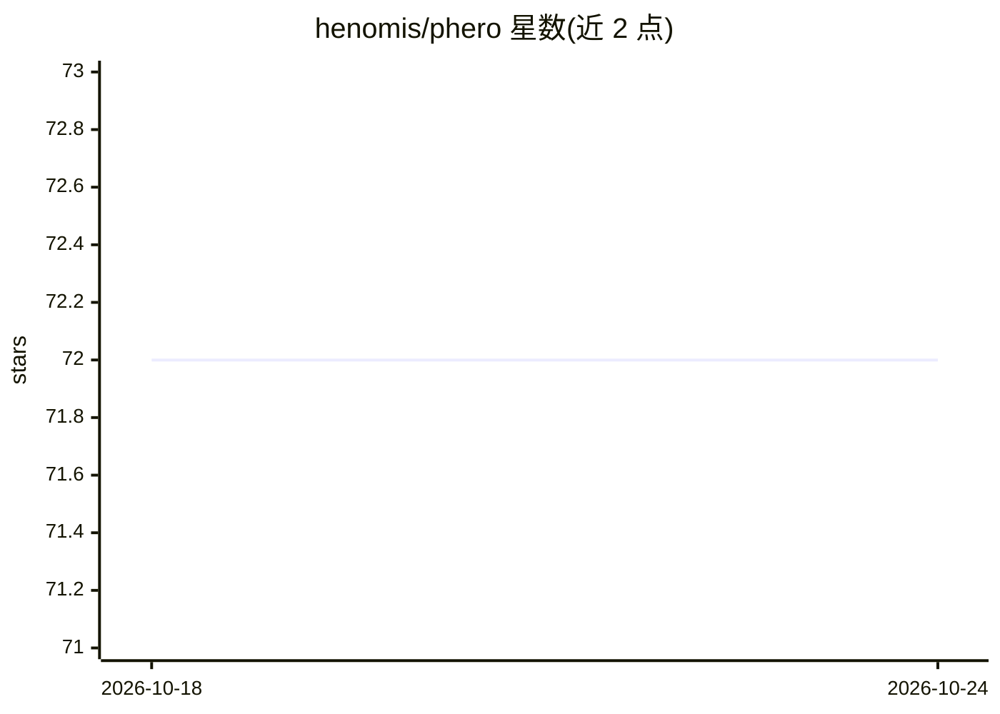

# henomis/phero

⭐ 73 · Go · Apache-2.0 · 推送 2026-10-19 · [GitHub](https://github.com/henomis/phero) · [官网](http://simonevellei.com/phero/) · 个人维护

**Go 语言多智能体 AI 系统构建框架**

Go 语言多智能体框架，提供核心编排包（agent）、LLM 抽象层（支持 OpenAI 兼容端点、Anthropic、Google Gemini）、运行时 agent 接力（handoffs）、A2A 协议与 NATS 微服务形式的跨进程 agent 通信。内置函数工具（自动 JSON Schema）、SKILL.md 技能系统、MCP 集成、RAG 管道（Qdrant/pgvector/Weaviate 向量库）、LLM 中间件（重试、限流、护栏、语义缓存）与 span 级 tracing（文本树/NDJSON/OpenTelemetry）。面向用 Go 构建多智能体应用的开发者，要求 Go 1.25.5+ 与至少一个 LLM provider。

## 筛选速览

| 维度 | 判定 | 备注 |
|---|---|---|
| AI 角色 | `ai-ecosystem` | LLM/agent 周边工具 |
| 许可风险 | `permissive` | Apache-2.0 |
| 部署形态 | `None` |  |
| 模型依赖 | local-ok | 支持本地模型 |
| 硬件要求 | — | 无带数字的原话,不猜 |
| 安装摩擦 | `low` | 无编译、无系统依赖或容器化 |
| 成熟度 | — | 结构信号不足 |

## 能力要点

- 多智能体编排与运行时 handoffs（含 fan-out）
- A2A 协议与 NATS Agent Protocol 跨进程 agent 通信
- 内置 RAG 管道，支持 Qdrant/pgvector/Weaviate 向量库
- LLM 中间件（重试/限流/护栏/语义缓存）与 OpenTelemetry 追踪

## 适用场景

- 用 Go 构建多智能体工作流（编排者-工人、辩论委员会等）
- 将 agent 通过 A2A 或 NATS 暴露为跨进程服务
- 搭建带语义记忆与 RAG 的对话式 agent

## 场景标签

`多智能体` `Agent 框架` `RAG` · 领域:Agent 开发

## 证据(README 行号)

> L7: Phero is a modern Go framework for building multi-agent AI systems. Like ants in a colony, agents in Phero cooperate
> L27: - **🧩 LLM abstraction** Work with OpenAI-compatible endpoints (OpenAI, Ollama, etc.), Anthropic and Google Gemini

## 星数曲线

2026-10-18 72 → 2026-10-24 72（+0）

---
*卡片 v1 · prompt 1.4 · 生成 2026-10-24 · 置信度 high · 依据 README sha `71cc67b8607f` · [字段定义](../../DATASET.md)*
