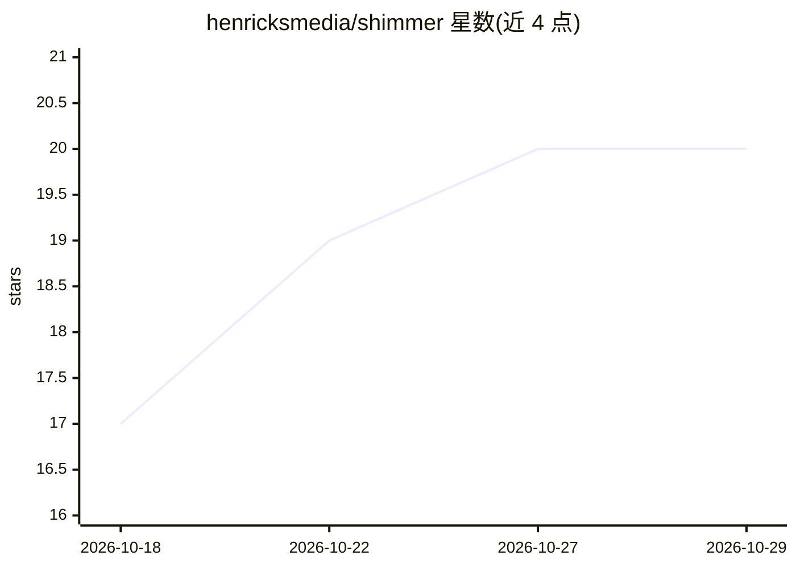

# henricksmedia/shimmer

⭐ 20 · Python · NOASSERTION · 推送 2026-09-25 · [GitHub](https://github.com/henricksmedia/shimmer) · [官网](https://treqmusic.com/tools/shimmer) · 个人维护

**清理 AI 音乐生成伪影并完成发行母带处理的离线工具**

面向用 Suno、Udio 等 AI 音乐工具生成曲目的音乐人的本地母带处理套件。分两步：先通过十张『你听到什么』卡片（陷波滤波、齿音消除、频谱降噪等）针对性清除 AI 生成在 5–12 kHz 留下的嘶声与金属振铃，再做响度目标、音色塑形与真峰值限制的母带处理。提供 Original/Processed/Removed 三轨对比试听与响度匹配 A/B，预览、导出、批处理、Remix 与命令行共用同一 render() 路径。免费、离线运行，Python 3.11+，通过启动脚本用 uv 构建私有环境，浏览器访问本地界面；MP3/M4A 需另装 ffmpeg。

## 筛选速览

| 维度 | 判定 | 备注 |
|---|---|---|
| AI 角色 | `ai-ecosystem` | LLM/agent 周边工具 |
| 许可风险 | `none` | NOASSERTION |
| 部署形态 | `library` | 以包/库形式分发 |
| 模型依赖 | — | README 未给出锁定关系 |
| 硬件要求 | — | 无带数字的原话,不猜 |
| 安装摩擦 | `medium` | 含编译或系统依赖之一 |
| 成熟度 | — | 结构信号不足 |

## 能力要点

- 卡片式伪影处理：每张卡对应一个工具（陷波、齿音消除、频谱降噪等）
- Original/Processed/Removed 三轨即时切换试听，Removed 轨作为过度处理的检查
- 预览/导出/批处理/Remix/CLI 共用同一 render() 函数，所听即所得
- Release check 输出发行就绪判定及 Spotify/Apple Music 等平台响度预估

## 适用场景

- 把我用 Suno 生成的歌清理掉高频嘶声后做成可发行母带
- 对比处理前后与被移除部分，确认没有误伤人声和旋律
- 批量处理整张专辑并检查各平台上传前的响度与峰值

## 场景标签

 · 领域:音频处理/音乐制作

## 证据(README 行号)

> L7: *A free, offline mastering suite built for tracks made with Suno, Udio, and other AI music tools.*
> L24: That noise is a **generation artifact**. AI music models build audio in ways
> L25: that leave behind hiss, flicker, and metallic ringing in the high

## 星数曲线

2026-10-18 17 → 2026-10-29 20（+3）

---
*卡片 v1 · prompt 1.4 · 生成 2026-10-28 · 置信度 mid · 依据 README sha `aeab4ee71e65` · [字段定义](../../DATASET.md)*
