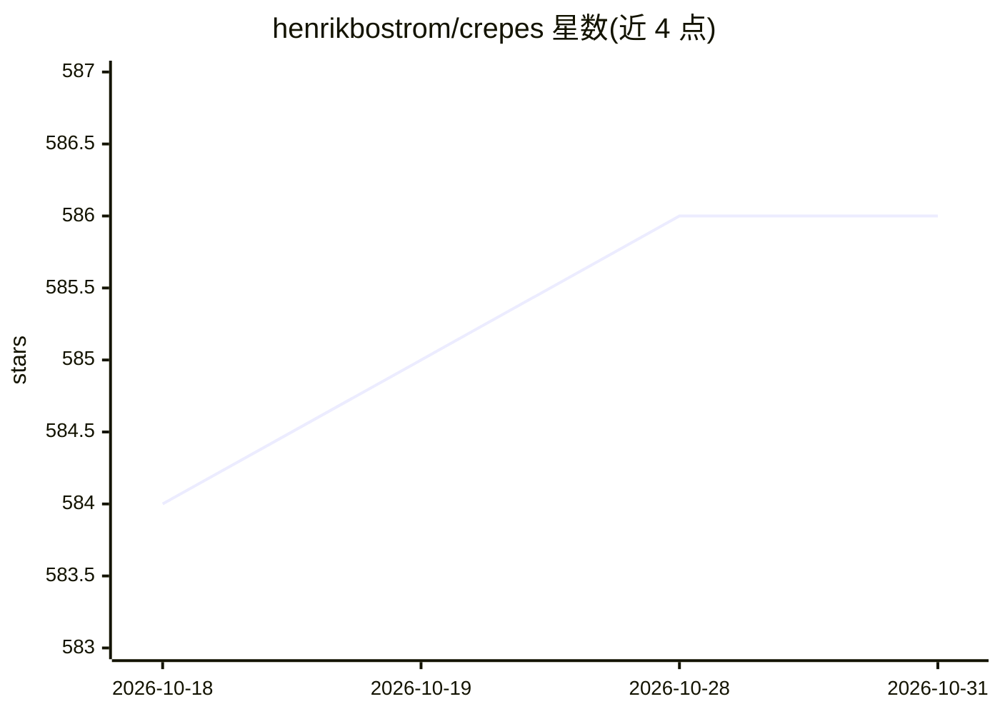

# henrikbostrom/crepes

⭐ 586 · Python · BSD-3-Clause · 推送 2026-07-08 · [GitHub](https://github.com/henrikbostrom/crepes) · 个人维护

**共形预测 Python 库：把分类/回归模型输出转为带覆盖保证的预测集与区间**

在任意标准分类器/回归器之上实现标准与 Mondrian 共形分类器、回归器和预测系统的 Python 包，将原始预测转为校准的 p 值、累积分布函数、预测集与预测区间，附带覆盖保证。提供 crepes.extras 模块内置难度估计器、非一致性得分与 Mondrian 分类器选项，也支持自定义函数；crepes.martingales 模块用于检验可交换性假设。支持在线校准的半在线共形预测器，可从 PyPI 与 conda-forge 安装。

## 筛选速览

| 维度 | 判定 | 备注 |
|---|---|---|
| AI 角色 | `ai-native` | 本体是模型或模型工具 |
| 许可风险 | `permissive` | BSD-3-Clause |
| 部署形态 | `library` | 以包/库形式分发 |
| 模型依赖 | — | README 未给出锁定关系 |
| 硬件要求 | — | 无带数字的原话,不猜 |
| 安装摩擦 | `low` | 无编译、无系统依赖或容器化 |
| 成熟度 | — | 结构信号不足 |

## 能力要点

- 在任意 sklearn 分类/回归器上生成带覆盖保证的预测集与预测区间
- 支持标准、归一化与 Mondrian 共形分类器/回归器/预测系统
- crepes.extras 提供难度估计器与 Mondrian 分类器等标准选项
- 支持 online=True 在线校准的半在线共形预测

## 适用场景

- 给分类模型输出校准的预测集与 p 值并评估错误率
- 为回归模型生成可按难度归一化的预测区间
- 按对象分组控制错误水平的 Mondrian 共形预测
- 用共形测试鞅检验数据可交换性假设

## 场景标签

`模型评测` · 领域:评测与运维

## 证据(README 行号)

> L10: `crepes` is a Python package for conformal prediction that implements conformal classifiers,
> L16: The `crepes` package implements standard and Mondrian conformal

## 星数曲线

2026-10-18 584 → 2026-10-31 586（+2）

---
*卡片 v1 · prompt 1.4 · 生成 2026-10-21 · 置信度 high · 依据 README sha `fbae0d814c07` · [字段定义](../../DATASET.md)*
