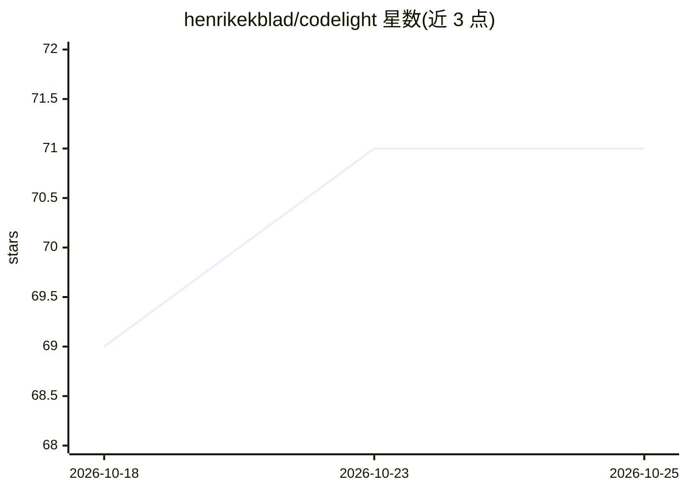

# henrikekblad/codelight

⭐ 71 · Python · MIT · 推送 2026-10-12 · [GitHub](https://github.com/henrikekblad/codelight) · 个人维护

**多编码 agent 远程监控面板：跨设备看状态、批权限、答提问**

由 Python 守护进程与多端客户端组成的编码 agent 状态与远程控制系统：通过 hooks 检测 Claude Code、Codex、Copilot、Cursor、Grok、OpenCode 等 agent，采集工作/等待/空闲状态与用量，经 WebSocket（mDNS 发现）推送至 GeekMagic Ultra 桌面屏（ESP8266 固件）、Android 小组件、GNOME/KDE Plasma 面板与 VSCode 扩展。开启 --remote-control 后可在远程批准权限提示、回答 agent 问题，对 OpenCode 还可下发新指令。各 agent 能力覆盖存在差异（如 Cursor CLI 仅 deny、Grok 无法远程批准）。

## 筛选速览

| 维度 | 判定 | 备注 |
|---|---|---|
| AI 角色 | `ai-ecosystem` | LLM/agent 周边工具 |
| 许可风险 | `permissive` | MIT |
| 部署形态 | `desktop` | 安装包/桌面程序 |
| 模型依赖 | — | README 未给出锁定关系 |
| 硬件要求 | — | 无带数字的原话,不猜 |
| 安装摩擦 | `low` | 无编译、无系统依赖或容器化 |
| 成熟度 | — | 结构信号不足 |

## 能力要点

- 支持 6 种编码 agent 的状态、用量与对话跟踪
- 远程批准权限提示与回答 agent 问题（Android/GNOME/VSCode）
- ESP8266 固件驱动 GeekMagic Ultra 桌面屏显示用量条与状态
- 持久化的文件夹与命令审批存于 agent 中立策略

## 适用场景

- 离开键盘时用手机批准 agent 的权限请求或回答其提问
- 在桌面屏/面板上同时监控多个编码 agent 的状态与 token 用量
- 在 VSCode 内查看 agent 状态并处理其提问

## 场景标签

`LLM 可观测性` · 领域:评测与运维

## 证据(README 行号)

> L37: |**companion/**|Python daemon that detects supported agents, installs their hooks, polls usage where available, pus
> L46: Run the companion with `--remote-control` (requires `--secret`) and codelight

## 星数曲线

2026-10-18 69 → 2026-10-25 71（+2）

---
*卡片 v1 · prompt 1.4 · 生成 2026-10-24 · 置信度 high · 依据 README sha `32285efc0e27` · [字段定义](../../DATASET.md)*
