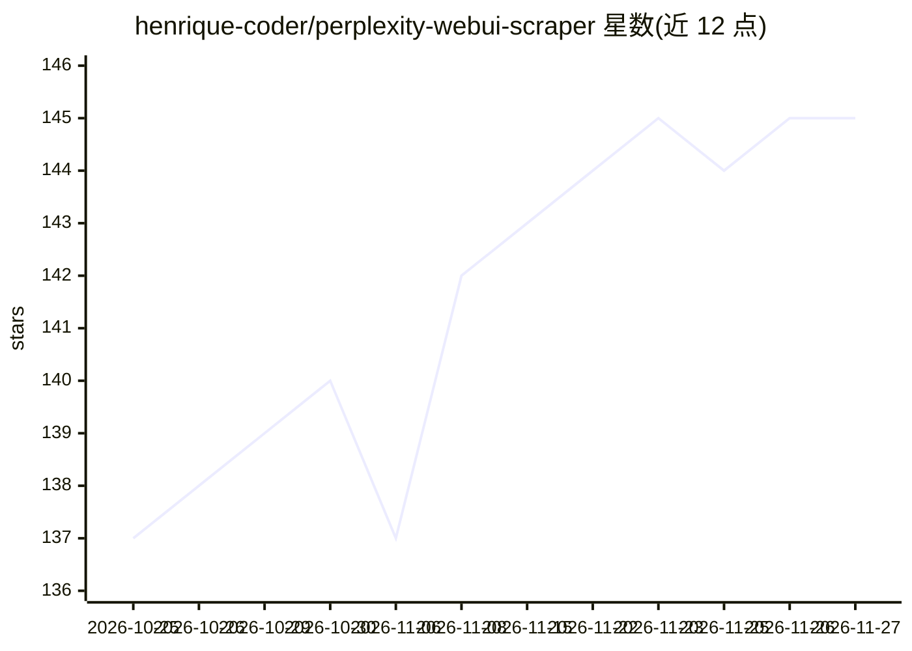

# henrique-coder/perplexity-webui-scraper

⭐ 145 · Python · MIT · 推送 2026-11-23 · [GitHub](https://github.com/henrique-coder/perplexity-webui-scraper) · [官网](https://perplexity-webui-scraper.readthedocs.io) · 个人维护

**Perplexity WebUI 的非官方 Python 客户端、CLI、MCP 服务器与 OpenAI 兼容 API**

调用 Perplexity WebUI 的未公开端点实现对话、文件上传与流式输出，非抓取页面 HTML。需 Perplexity 账户会话凭证（wsk_ 压缩 token 或原始 cookie），免费账户限文本提示，Pro/Max 模型与文件上传需付费。提供 token 生成/转换命令、OpenAI 兼容 REST API（仅 /v1/chat/completions，含流式与图片 Data URL）、MCP 服务器，可将各模型作为工具暴露给 AI agent。发布于 PyPI 与 GHCR 容器镜像。README 声明非官方工具，内部 API 可能变更。

## 筛选速览

| 维度 | 判定 | 备注 |
|---|---|---|
| AI 角色 | `ai-ecosystem` | LLM/agent 周边工具 |
| 许可风险 | `permissive` | MIT |
| 部署形态 | `library` | 以包/库形式分发 |
| 模型依赖 | — | README 未给出锁定关系 |
| 硬件要求 | — | 无带数字的原话,不猜 |
| 安装摩擦 | `low` | 无编译、无系统依赖或容器化 |
| 成熟度 | — | 结构信号不足 |

## 能力要点

- Python 库、CLI、OpenAI 兼容 REST API、MCP 服务器四种形态
- wsk_ 压缩凭证生成、转换与还原的 token 命令
- 模型可用性状态（available/unknown/unavailable）与账户层级检查
- MCP 服务器将每个 Perplexity 模型暴露为 AI agent 工具

## 适用场景

- 用 OpenAI 兼容接口接入 Perplexity 模型做问答
- 为 Claude Desktop 等 agent 配置 Perplexity 搜索问答工具
- 命令行生成和管理 Perplexity 会话凭证

## 场景标签

`模型网关` · 领域:Agent 开发

## 证据(README 行号)

> L5: Unofficial Python client for Perplexity's WebUI-backed endpoints. It does not scrape page HTML.
> L15: This unofficial client uses undocumented Perplexity WebUI endpoints for conversations, file uploads, and streaming;
> L125: `POST /v1/chat/completions` is the only text-generation endpoint. It is a read-only question-answering mirror of P

## 星数曲线

2026-10-25 137 → 2026-11-27 145（+8）

---
*卡片 v1 · prompt 1.4 · 生成 2026-11-27 · 置信度 high · 依据 README sha `c5644ed801ed` · [字段定义](../../DATASET.md)*
