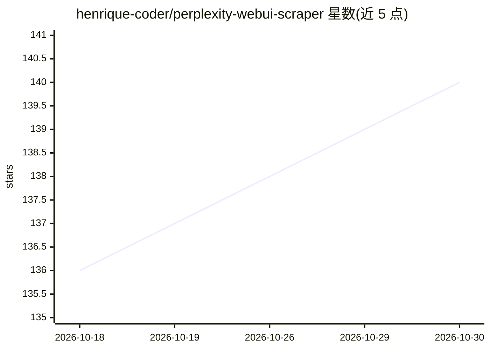

# henrique-coder/perplexity-webui-scraper

⭐ 140 · Python · MIT · 推送 2026-10-26 · [GitHub](https://github.com/henrique-coder/perplexity-webui-scraper) · [官网](https://perplexity-webui-scraper.readthedocs.io) · 个人维护

**通过逆向 Perplexity WebUI 接口获取 AI 回答的 Python 库与 API/MCP 服务**

非官方 Python 库，使用 Perplexity 未公开的 WebUI 端点与浏览器会话 token 实现对话、文件上传与流式输出；可选 extras 提供 OpenAI 兼容 REST API 服务器和 MCP 服务器，把每个 Perplexity 模型作为独立工具暴露给 Claude Desktop 等 agent。需要 Perplexity 账号，免费账号仅支持文本，Pro/Max 模型与文件上传需付费档位。基于未公开内部 API，可能随时变更；不支持工具执行与完整 OpenAI API。发布到 PyPI，容器镜像发布到 GHCR。

## 筛选速览

| 维度 | 判定 | 备注 |
|---|---|---|
| AI 角色 | `ai-ecosystem` | LLM/agent 周边工具 |
| 许可风险 | `permissive` | MIT |
| 部署形态 | `library` | 以包/库形式分发 |
| 模型依赖 | — | README 未给出锁定关系 |
| 硬件要求 | — | 无带数字的原话,不猜 |
| 安装摩擦 | `low` | 无编译、无系统依赖或容器化 |
| 成熟度 | — | 结构信号不足 |

## 能力要点

- 基于会话 token 的逆向 WebUI 端点访问，支持对话、流式与文件上传
- OpenAI 兼容 REST API（Responses 与 Chat Completions 子集，支持流式）
- MCP 服务器把每个 Perplexity 模型作为独立工具暴露给 AI agent
- 邮件认证（含 TOTP）的会话 token 生成 CLI

## 适用场景

- 用 OpenAI 兼容客户端调用本地网关访问 Perplexity 模型
- 给 Claude Desktop 等 agent 接入 Perplexity 作为 MCP 工具
- 在脚本中以 Python 库形式获取 Perplexity 的回答

## 场景标签

`模型网关` `网页抓取` · 领域:Agent 开发

## 证据(README 行号)

> L15: This unofficial library uses undocumented Perplexity WebUI endpoints with a browser session token. It supports conv
> L111: ## OpenAI-compatible API
> L205: Expose every Perplexity model as a separate tool for AI agents (Claude Desktop, Antigravity, etc.):

## 星数曲线

2026-10-18 136 → 2026-10-30 140（+4）

---
*卡片 v1 · prompt 1.4 · 生成 2026-10-22 · 置信度 high · 依据 README sha `80c8278150ce` · [字段定义](../../DATASET.md)*
