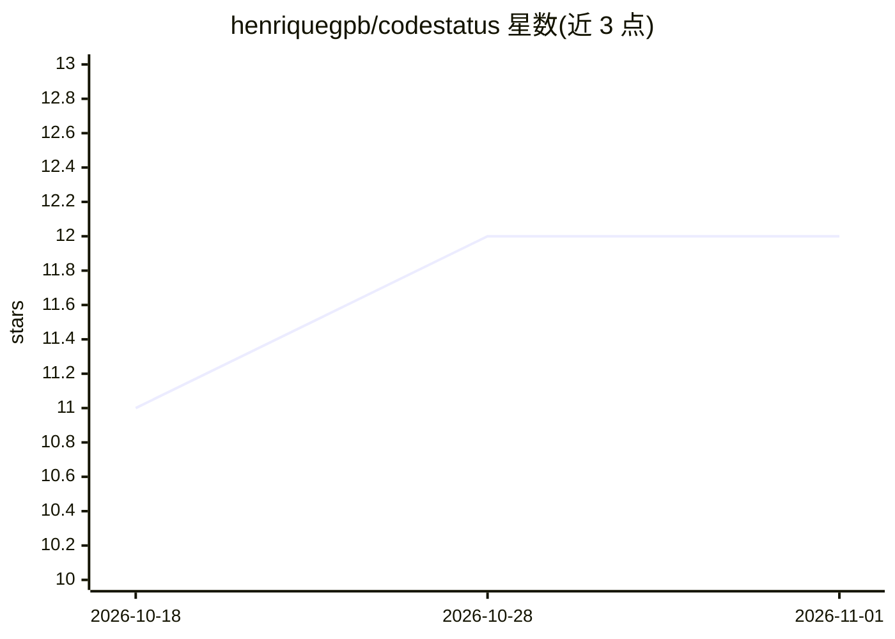

# henriquegpb/codestatus

⭐ 12 · Swift · MIT · 推送 2026-09-11 · [GitHub](https://github.com/henriquegpb/codestatus) · [官网](https://codestatus.dev) · 个人维护

**菜单栏应用：追踪 Claude Code/Codex 会话状态并提醒**

macOS 原生 Swift 应用与 Windows/Linux 的 Electron 应用（同仓库两套实现），通过 Claude Code 与 Codex 的官方生命周期 hooks 读取会话状态（工作中/空闲/待批准/待回答/失败），在菜单栏显示计数并在需要用户时发通知与声音，点击可跳回对应终端标签页。hook 二进制按元数据白名单读取，不复制提示词与回复内容；无账号、无服务器、无遥测。支持会话期间阻止 Mac 休眠、显示每日花费与配额。Windows/Linux 为移植版，部分能力未验证；项目自述为开发中。

## 筛选速览

| 维度 | 判定 | 备注 |
|---|---|---|
| AI 角色 | `ai-ecosystem` | LLM/agent 周边工具 |
| 许可风险 | `permissive` | MIT |
| 部署形态 | `None` |  |
| 模型依赖 | — | README 未给出锁定关系 |
| 硬件要求 | — | 无带数字的原话,不猜 |
| 安装摩擦 | `low` | 无编译、无系统依赖或容器化 |
| 成熟度 | `idea` | |

## 能力要点

- 以官方生命周期 hooks 为状态来源，不基于 CPU 猜测
- hook 二进制按元数据白名单读取，提示词/回复不出现在日志与 socket
- 同一套状态机以 Swift 与 TypeScript 双语言实现，测试用例相同
- agent 执行期间持有 PreventUserIdleSystemSleep 阻止 Mac 休眠

## 适用场景

- 并行跑多个 AI 编码会话，无需反复切窗口查看进度
- 会话等待批准或回答时收到通知与声音提醒
- 查看按天和按模型的编码代理花费与配额消耗

## 场景标签

 · 领域:开发者工具/agent 监控

## 证据(README 行号)

> L24: CodeStatus answers that without you looking. It tracks every Claude Code and Codex session on
> L41: **official lifecycle hooks** as the source of truth. Process observation is used only for

## 星数曲线

2026-10-18 11 → 2026-11-01 12（+1）

---
*卡片 v1 · prompt 1.4 · 生成 2026-11-01 · 置信度 high · 依据 README sha `d5fcc2be71ba` · [字段定义](../../DATASET.md)*
