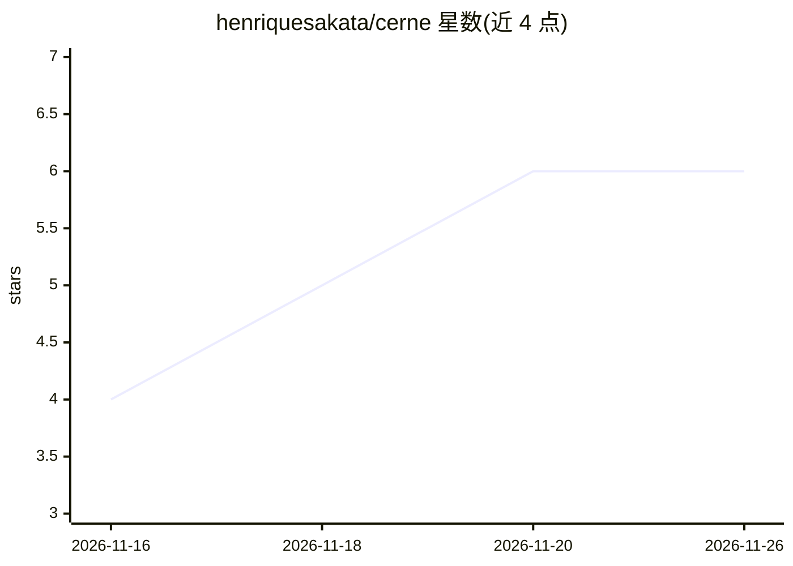

# henriquesakata/cerne

⭐ 6 · Go · Apache-2.0 · 推送 2026-11-25 · [GitHub](https://github.com/henriquesakata/cerne) · 个人维护

**为 AI agent 开发提供带生命周期的活文档工作流**

cerne 是一个面向 AI agent 协作开发的工程工作流 CLI：将功能、决策、笔记、runbook 等项目知识作为结构化数据存入用户自有 git 仓库，通过门控命令推进 candidate→done 生命周期；`cerne pull` 向项目的 .docs/ 目录投影仅当前有效的状态与文档，历史保留在后端可搜索。机制上用确定性 lint 检查文档陈旧、拒绝 agent 会话自行批准规格，审批/验收默认保留给人。单一 Go 二进制，本地运行，无 SaaS，Apache 2.0。

## 筛选速览

| 维度 | 判定 | 备注 |
|---|---|---|
| AI 角色 | `ai-ecosystem` | LLM/agent 周边工具 |
| 许可风险 | `permissive` | Apache-2.0 |
| 部署形态 | `None` |  |
| 模型依赖 | — | README 未给出锁定关系 |
| 硬件要求 | — | 无带数字的原话,不猜 |
| 安装摩擦 | `low` | 无编译、无系统依赖或容器化 |
| 成熟度 | — | 结构信号不足 |

## 能力要点

- 功能/决策等实体有状态机生命周期，转换由门控命令驱动并记录为 git 事件
- .docs/ 投影只让 agent 读取当前状态，96%+ 文档留在后端按需搜索
- spec 批准与结果接受默认仅限人类，agent 会话被 CERNE_ACTOR 标记并拒绝这两个转换
- 通过 Skills/Hooks 接入 agent，另提供只读 MCP server

## 适用场景

- 多个 AI agent 长期协作同一代码库时管理规格与决策
- 防止 agent 引用已被取代的设计决策
- 控制注入 agent 上下文的文档量与新鲜度
- 跨会话、跨机器沉淀项目知识与约定

## 场景标签

`工作流自动化` `知识库管理` · 领域:效率与自动化

## 证据(README 行号)

> L5:  An engineering workflow for software built with AI agents.
> L30: cerne is not a wiki, an agent memory or a documentation generator. It gives the work itself a lifecycle: a feature 
> L113: The agent works through the CLI; its read commands take `--json`. `cerne init` installs what teaches it the workfl

## 星数曲线

2026-11-16 4 → 2026-11-26 6（+2）

---
*卡片 v1 · prompt 1.4 · 生成 2026-11-20 · 置信度 high · 依据 README sha `ab7251469aa8` · [字段定义](../../DATASET.md)*
