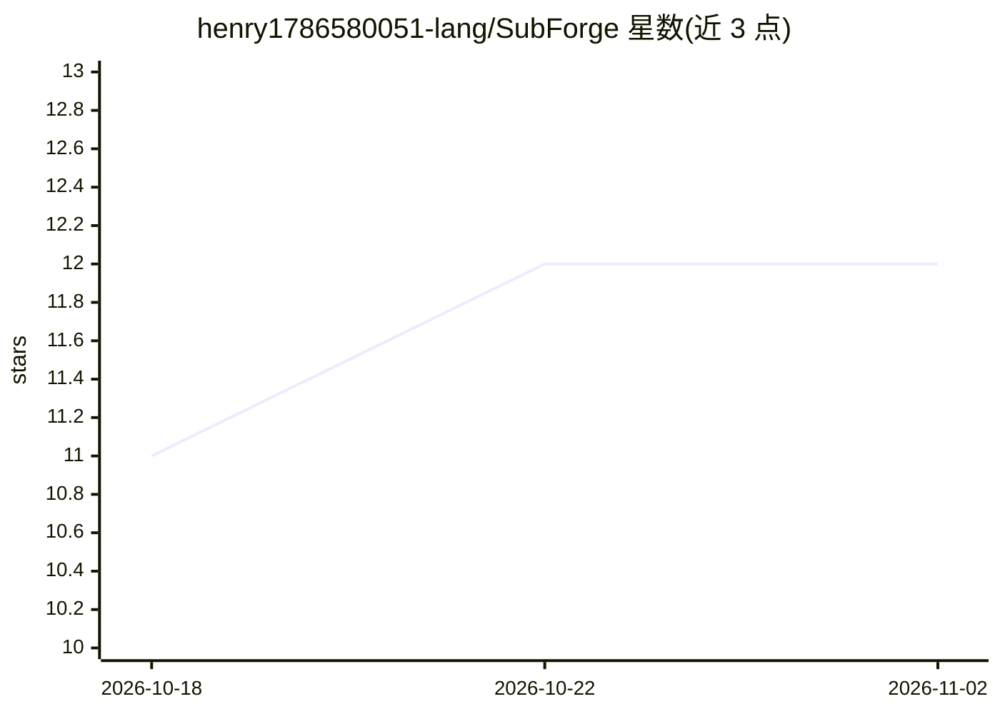

# henry1786580051-lang/SubForge

⭐ 12 · Python · GPL-3.0 · 推送 2026-10-28 · [GitHub](https://github.com/henry1786580051-lang/SubForge) · [官网](https://henry1786580051-lang.github.io/SubForge/) · 个人维护 · 中文 README

**本地优先的 AI 双语字幕工作台，面向视频创作者**

一体化双语字幕工作台：素材导入、本地语音转录（WhisperX，Apple Silicon 用 MLX、Windows 用 CTranslate2，可选 CUDA/CPU）、词级对齐与 VAD 校准、pyannote 说话人聚类、智能断句与对话感知翻译，配合质量门检查漏译/错位/重复，编辑后导出 SRT/VTT/ASS 等格式。云端翻译支持 MiniMax（Anthropic 协议）、DeepSeek、智谱 GLM、NVIDIA NIM、OpenAI、通义千问等。提供 macOS DMG 与 Windows EXE 安装包（捆绑运行时），macOS 为 ad-hoc 签名未公证；Linux 仅源码运行。

## 筛选速览

| 维度 | 判定 | 备注 |
|---|---|---|
| AI 角色 | `ai-native` | 本体是模型或模型工具 |
| 许可风险 | `viral` | GPL-3.0 |
| 部署形态 | `desktop` | 安装包/桌面程序 |
| 模型依赖 | — | README 未给出锁定关系 |
| 硬件要求 | — | 无带数字的原话,不猜 |
| 安装摩擦 | `medium` | 含编译或系统依赖之一 |
| 成熟度 | — | 结构信号不足 |

## 能力要点

- 本地语音识别：MLX Whisper（Apple Silicon）/ Faster-Whisper（Windows，可选 CUDA 或 CPU）
- WhisperX forced alignment + TEN-VAD 词级边界校准，41 种语言对齐模型可下载
- pyannote Community-1 说话人聚类（1–10 人），标签不写入最终字幕
- 对话感知翻译与质量门（漏译/错位/重复/占位语/思考内容泄漏检查），失败条目局部重试

## 适用场景

- 把视频素材转成可发布的双语字幕文件
- 访谈等多说话人视频做转录与说话人轮次感知翻译
- 本地完成语音识别，仅翻译环节使用云端服务

## 场景标签

`语音识别` · 领域:感知与多模态

## 证据(README 行号)

> L24: SubForge 将素材导入、语音转录、断句翻译、字幕编辑与导出放在同一个工作区，面向视频创作者和字幕本地化工作。选择本地语音识别时，音频处理在设备上完成；使用云端翻译服务时，所需字幕文本会发送给所选服务商。
> L64: |本地语音识别|WhisperX：Apple Silicon 使用 MLX Whisper；Windows 使用 Faster-Whisper/CTranslate2，可选 CUDA 或 CPU|

## 星数曲线

2026-10-18 11 → 2026-11-02 12（+1）

---
*卡片 v1 · prompt 1.4 · 生成 2026-11-01 · 置信度 high · 依据 README sha `d4e38dbc3d67` · [字段定义](../../DATASET.md)*
