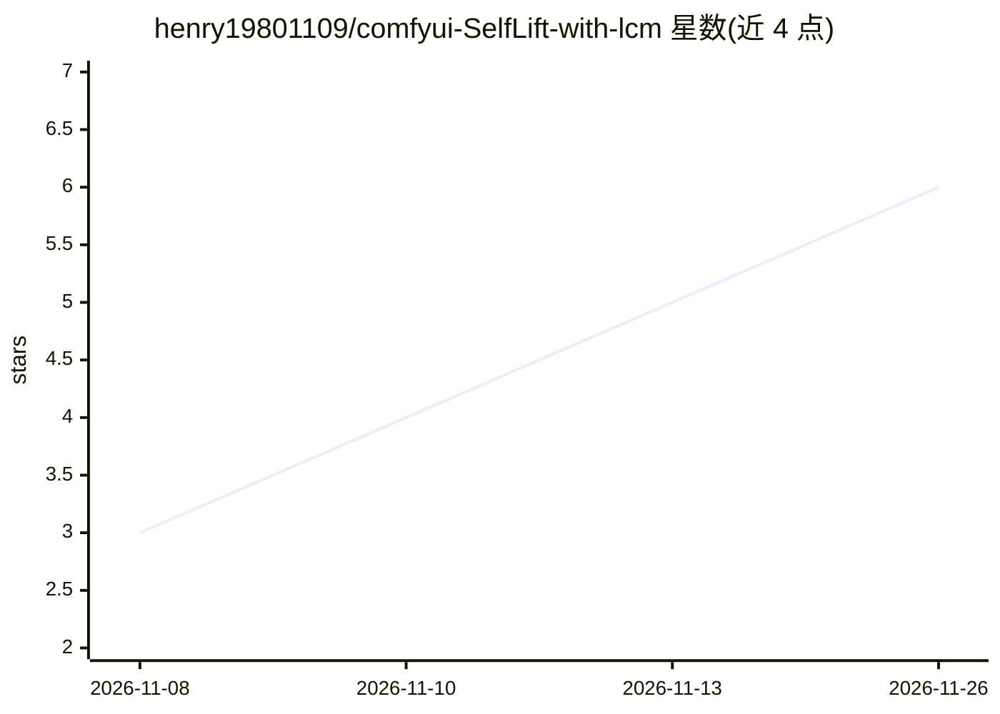

# henry19801109/comfyui-SelfLift-with-lcm

⭐ 6 · Python · MIT · 推送 2026-11-05 · [GitHub](https://github.com/henry19801109/comfyui-SelfLift-with-lcm) · 个人维护

**ComfyUI 渐进分辨率采样插件：低分辨率起步再提升，免训练加速生成**

以 ComfyUI 自定义节点形式实现的 SelfLift-zero 渐进分辨率采样：去噪前段在低分辨率运行，过渡后提升到全分辨率完成剩余步骤，NFE 总数不变，无需训练。提供三个节点——图像版（Euler/LCM，支持蒸馏少步模型）、实验性 MiniMax H3 音视频版（可选外部 latent 上采样器、高分辨率分块）、以及 H3 时间稳定性修正 TST 节点。仅接受标准 euler 与 lcm 采样器；H3 路径与 TST 为实验性质，依赖可能随 ComfyUI 版本变化的内部接口。

## 筛选速览

| 维度 | 判定 | 备注 |
|---|---|---|
| AI 角色 | `ai-native` | 本体是模型或模型工具 |
| 许可风险 | `permissive` | MIT |
| 部署形态 | `library` | 以包/库形式分发 |
| 模型依赖 | — | README 未给出锁定关系 |
| 硬件要求 | — | 无带数字的原话,不猜 |
| 安装摩擦 | `medium` | 含编译或系统依赖之一 |
| 成熟度 | `idea` | |

## 能力要点

- 渐进分辨率采样：低分辨率前缀 + 全分辨率收尾，NFE 数量不变、免训练
- 支持 LCM 少步蒸馏模型（LCM、SDXL-Lightning、SD-Turbo）
- TST 节点在推理期修正 H3 视频帧间闪烁与身份漂移，约 1-2% 额外开销
- 内置分阶段计时、内存诊断与调试环境变量

## 适用场景

- 在 ComfyUI 中加速扩散模型图像生成而不重训模型
- 少步蒸馏模型（LCM/SD-Turbo）的采样流程配置
- 改善 MiniMax H3 视频生成的帧间一致性与闪烁问题
- VRAM 受限时用 highres_tiling 分块完成高分辨率阶段

## 场景标签

`图像生成` `视频生成` · 领域:内容生成

## 证据(README 行号)

> L5: SelfLift Progressive Sampler (MiniMax H3) in a ComfyUI workflow
> L7: Progressive-resolution sampling for ComfyUI: run the early denoising steps at low resolution, lift the result to ful
> L36: |Node|Type|What it does|

## 星数曲线

2026-11-08 3 → 2026-11-26 6（+3）

---
*卡片 v1 · prompt 1.4 · 生成 2026-11-26 · 置信度 mid · 依据 README sha `516e8becb646` · [字段定义](../../DATASET.md)*
