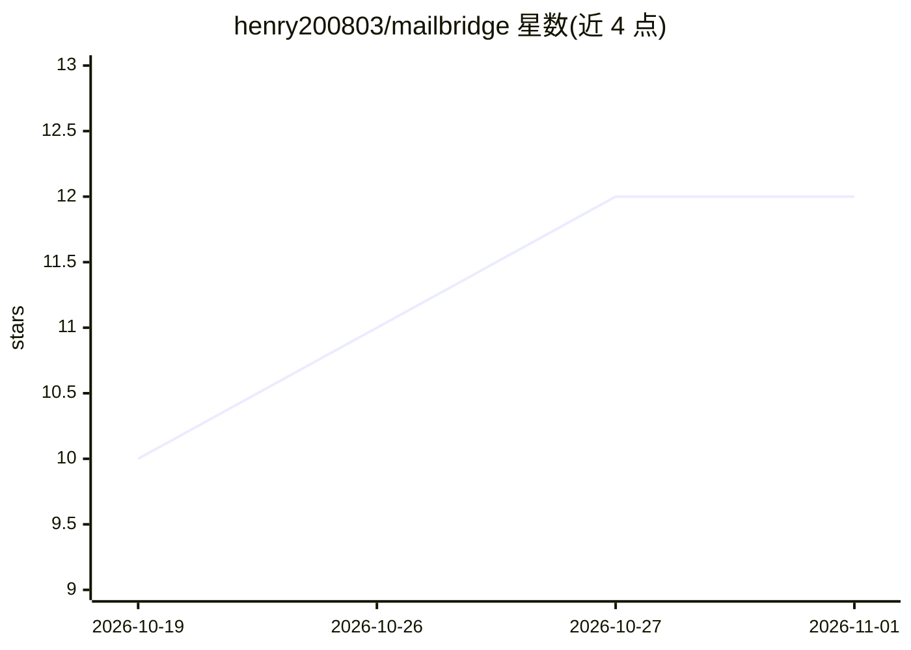

# henry200803/mailbridge

⭐ 12 · Python · MIT · 推送 2026-08-10 · [GitHub](https://github.com/henry200803/mailbridge) · 个人维护 · 中文 README

**面向 AI agent 的邮件 MCP 服务器，覆盖 IMAP/Graph 多邮箱**

用纯 Python 实现的 MCP（stdio JSON-RPC）邮件服务器，让 Claude、Codex、Cursor、Cline 等 MCP 客户端获得完整邮件客户端能力：搜索、读取、草稿、发送、附件下载、跨账户摘要、批量导出 CSV/JSON。后端覆盖 iCloud、Gmail、QQ/163/126 等任意 IMAP/SMTP 邮箱，Outlook/Exchange 走 Microsoft Graph OAuth（需免费 Entra 应用注册）。零第三方依赖，Python 3.9+ 解释器即可运行；发送与永久删除需显式 confirm=true。提供中英双语文档与配置向导。

## 筛选速览

| 维度 | 判定 | 备注 |
|---|---|---|
| AI 角色 | `ai-ecosystem` | LLM/agent 周边工具 |
| 许可风险 | `permissive` | MIT |
| 部署形态 | `library` | 以包/库形式分发 |
| 模型依赖 | — | README 未给出锁定关系 |
| 硬件要求 | — | 无带数字的原话,不猜 |
| 安装摩擦 | `low` | 无编译、无系统依赖或容器化 |
| 成熟度 | — | 结构信号不足 |

## 能力要点

- 14 个邮件工具：搜索/读取/发送/附件/批量导出/标记/移动等
- 零第三方依赖，Python 3.9+ 直接运行，无需 pip install
- IMAP/SMTP 与 Microsoft Graph 双后端，跨多账户操作
- 发送与永久删除强制 confirm=true 门控，凭据仅存本地 0600 文件

## 适用场景

- 让 Claude/Codex/Cursor 等 agent 直接管理我的个人邮箱
- 跨 iCloud、Gmail、QQ、163 等多个账户统一搜索与处理邮件
- 把邮箱操作接入 MCP 工作流做批量整理与导出

## 场景标签

 · 领域:AI agent 工具/邮件

## 证据(README 行号)

> L3: **The email MCP server — give Claude, Codex, Cursor or any AI agent a real mail client for iCloud, Outlook, Gmail, Q
> L17: Most agent platforms' built-in connectors cover Gmail and Microsoft 365 work accounts. They do not cover personal i
> L118: server/          MCP server (stdio JSON-RPC), IMAP + Graph backends, OAuth, i18n

## 星数曲线

2026-10-19 10 → 2026-11-01 12（+2）

---
*卡片 v1 · prompt 1.4 · 生成 2026-11-01 · 置信度 mid · 依据 README sha `3f5a2c4416eb` · [字段定义](../../DATASET.md)*
