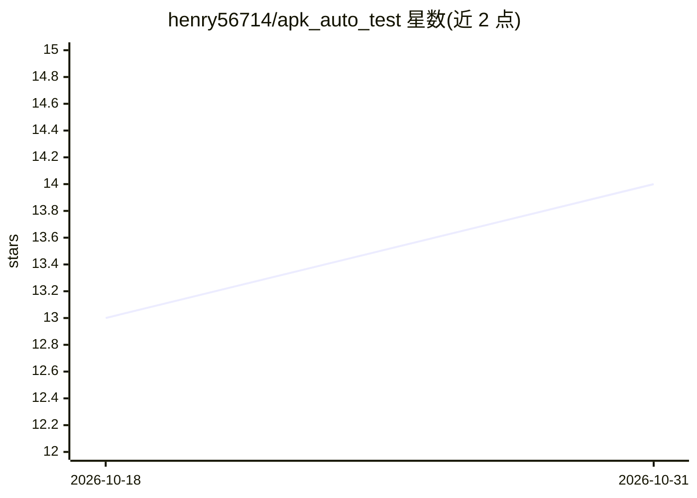

# henry56714/apk_auto_test

⭐ 14 · Python · 推送 2026-09-10 · [GitHub](https://github.com/henry56714/apk_auto_test) · 个人维护 · 中文 README

**无需 root 的 Android APK 性能与稳定性 adb 自动化测试工具**

两个独立的 Python + adb 测试工具：perf_auto_test 监控 CPU 峰值、内存增长与阈值突破，stability_auto_test 捕获 Java/Native 崩溃、ANR 与进程死亡。对被测应用零侵入（不改包、免 root），按包名自动发现进程，支持 1–24 小时长跑（小时级滚动文件、adb 断线重连退避）。每次运行产出 schema 校验的 report.json（供 LLM/CI 消费）与自包含 Plotly report.html；提供 Claude Code Skill、Python 库与独立 CLI 三种用法，另附故障注入自测 APK（Fault Lab，30+ 确定性故障）。限制：stability_auto_test 只监控已在运行的应用，不负责启动。

## 筛选速览

| 维度 | 判定 | 备注 |
|---|---|---|
| AI 角色 | `ai-enhanced` | 去掉 AI 部分产品仍成立 |
| 许可风险 | `none` | — |
| 部署形态 | `library` | 以包/库形式分发 |
| 模型依赖 | locked-api |  |
| 硬件要求 | — | 无带数字的原话,不猜 |
| 安装摩擦 | `low` | 无编译、无系统依赖或容器化 |
| 成熟度 | — | 结构信号不足 |

## 能力要点

- 纯 adb 非侵入，免 root、免改包，按包名自动发现进程
- report.json 经 JSON Schema Draft-07 校验，面向 LLM/CI 直接消费
- 崩溃/ANR 证据自动采集：logcat 切片、tombstone、ANR trace
- 1–24 小时长跑稳定，含 Fault Lab 故障注入自测 APK

## 适用场景

- 对 Android 应用做长时间性能压测并自动生成可交互报告
- 回归测试中捕获崩溃、ANR 并留存堆栈证据
- 把测试结果 JSON 直接喂给 LLM 或 CI 做自动化分析

## 场景标签

 · 领域:移动测试/质量工程

## 证据(README 行号)

> L5: Two independent Python + adb tools that automate Android APK testing — no app modification, no root, no debuggable b
> L20: **`report.json`** is the authoritative output — schema-validated (JSON Schema Draft-07), versioned, and structured 
> L74: ### Option 1 — Claude Code Skill

## 星数曲线

2026-10-18 13 → 2026-10-31 14（+1）

---
*卡片 v1 · prompt 1.4 · 生成 2026-10-31 · 置信度 mid · 依据 README sha `d3a089613522` · [字段定义](../../DATASET.md)*
