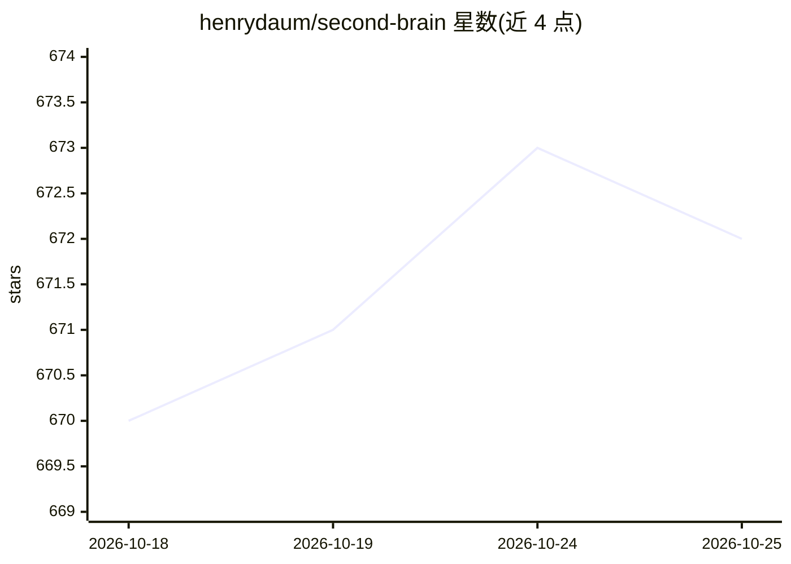

# henrydaum/second-brain

⭐ 672 · Python · MIT · 推送 2026-09-26 · [GitHub](https://github.com/henrydaum/second-brain) · 个人维护

**本地运行的 agent 操作系统：用 LLM 与文件智能完成个人任务**

在用户自己的机器上运行的 agentic 框架，以本地文件智能、工作流自动化与 LLM 组合完成任务，可通过 web UI、终端聊天及 Telegram 等消息平台交互。以 /setup 安装 essentials 工具包后按需连接 ChatGPT 账号（Codex）、OpenRouter、OpenAI/Anthropic/Gemini 或本地 Ollama 模型；通过 /packages 安装知识库检索、自维护记忆、Gmail 等扩展。agent 可在沙箱 iframe 中运行其编写的 HTML widgets。需 Python 3.11+ 与 Node 20.19+/22.12+，另提供 Dockerfile。

## 筛选速览

| 维度 | 判定 | 备注 |
|---|---|---|
| AI 角色 | `ai-native` | 本体是模型或模型工具 |
| 许可风险 | `permissive` | MIT |
| 部署形态 | `self-host` | docker 或自建部署 |
| 模型依赖 | local-ok | 支持本地模型 |
| 硬件要求 | — | 无带数字的原话,不猜 |
| 安装摩擦 | `low` | 无编译、无系统依赖或容器化 |
| 成熟度 | — | 结构信号不足 |

## 能力要点

- 本地运行，数据目录含配置、数据库、对话与 agent 工作区
- 多模型接入：ChatGPT 账号(Codex)、OpenRouter、Ollama 及 OpenAI 兼容端点
- /packages 扩展包：知识库检索、markdown 自维护记忆、Gmail、Telegram 前端
- agent 可写 HTML widgets 并在沙箱 iframe 运行

## 适用场景

- 在个人电脑上运行一个可连接多种模型的私有 agent 助手
- 索引并检索自己的 PDF、Office、图片与音频文件
- 通过 Telegram 或手机主屏 web UI 远程使用同一 agent
- 在服务器或 NAS 上以 Docker 长期运行

## 场景标签

`Agent 框架` `工作流自动化` `RAG` · 领域:Agent 开发

## 证据(README 行号)

> L75: |**Another provider**|OpenAI, Anthropic, Gemini, a local model via Ollama, or any OpenAI-compatible endpoint.|
> L69: It installs the `essentials` bundle (file tools, shell, web search, subagents and more) and asks how you want to co
> L81: - **More capabilities:** run `/packages install` (or open **Settings** in the web UI) to browse the store. Good one

## 星数曲线

2026-10-18 670 → 2026-10-25 672（+2）

---
*卡片 v1 · prompt 1.4 · 生成 2026-10-21 · 置信度 high · 依据 README sha `0c30f463f12e` · [字段定义](../../DATASET.md)*
