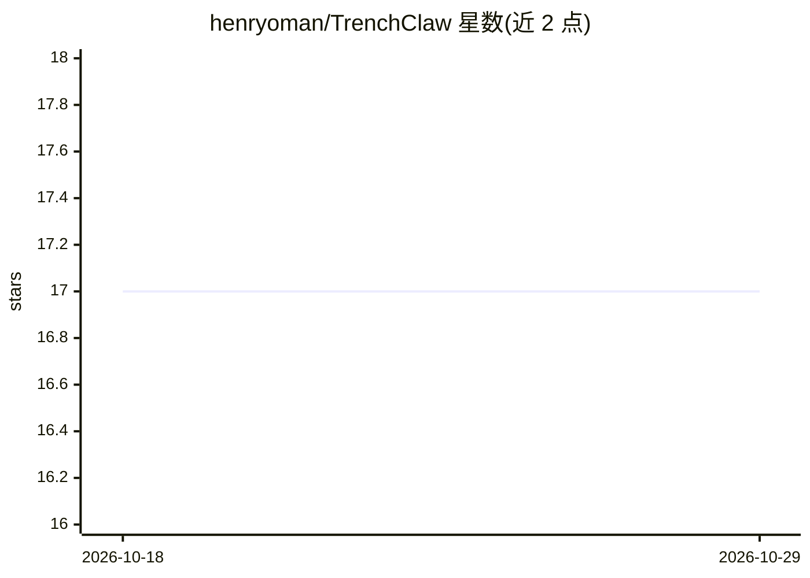

# henryoman/TrenchClaw

⭐ 17 · TypeScript · 推送 2026-10-08 · [GitHub](https://github.com/henryoman/TrenchClaw) · [官网](https://trenchclaw.vercel.app) · 个人维护

**面向 Solana 的 agentic AI 运行时：链上交易与研究助手**

用 Bun、@solana/kit、Svelte 与 Vercel AI SDK 构建的开源 agentic AI 运行时与个人 Solana 助手：通过聊天驱动执行模块化链上操作，支持 Helius RPC 数据读取、Dexscreener 市场/代币研究、Jupiter Ultra 交换与 Trigger API 流程、定时队列任务、钱包创建与转账，并提供桌面 GUI 展示聊天、钱包、活动与运行时状态。工具经 schema 校验与策略门控执行。README 自述当前处于实验阶段、安全性未完善，需 Helius、Jupiter Ultra 及 OpenRouter 或 Vercel AI Gateway 的 API key。

## 筛选速览

| 维度 | 判定 | 备注 |
|---|---|---|
| AI 角色 | `ai-native` | 本体是模型或模型工具 |
| 许可风险 | `none` | — |
| 部署形态 | `None` |  |
| 模型依赖 | locked-api |  |
| 硬件要求 | — | 无带数字的原话,不猜 |
| 安装摩擦 | `low` | 无编译、无系统依赖或容器化 |
| 成熟度 | `idea` | |

## 能力要点

- 基于 @solana/kit 6 与 Bun 构建，无 legacy web3.js v1 依赖
- 聊天驱动链上操作：Helius 读取、Jupiter Ultra 交换、Trigger API、队列任务
- 工具经 schema 校验与策略检查（确认门/拦截）后执行
- Svelte 桌面 GUI 集成聊天、钱包、活动与运行时状态

## 适用场景

- 通过对话让 agent 执行 Solana 交易与研究操作
- 运行自动化交易例程与定时交换任务
- 在本地 GUI 中管理钱包并监控 agent 运行时状态

## 场景标签

`金融量化` `工作流自动化` · 领域:效率与自动化

## 证据(README 行号)

> L30: TrenchClaw is an openclaw-like agentic ai harness and runtime for the Solana blockchain. It's a personal solana ass
> L44: - [x] AI chat with OpenRouter and Vercel AI Gateway

## 星数曲线

2026-10-18 17 → 2026-10-29 17（+0）

---
*卡片 v1 · prompt 1.4 · 生成 2026-10-29 · 置信度 high · 依据 README sha `e5c318d9c96e` · [字段定义](../../DATASET.md)*
