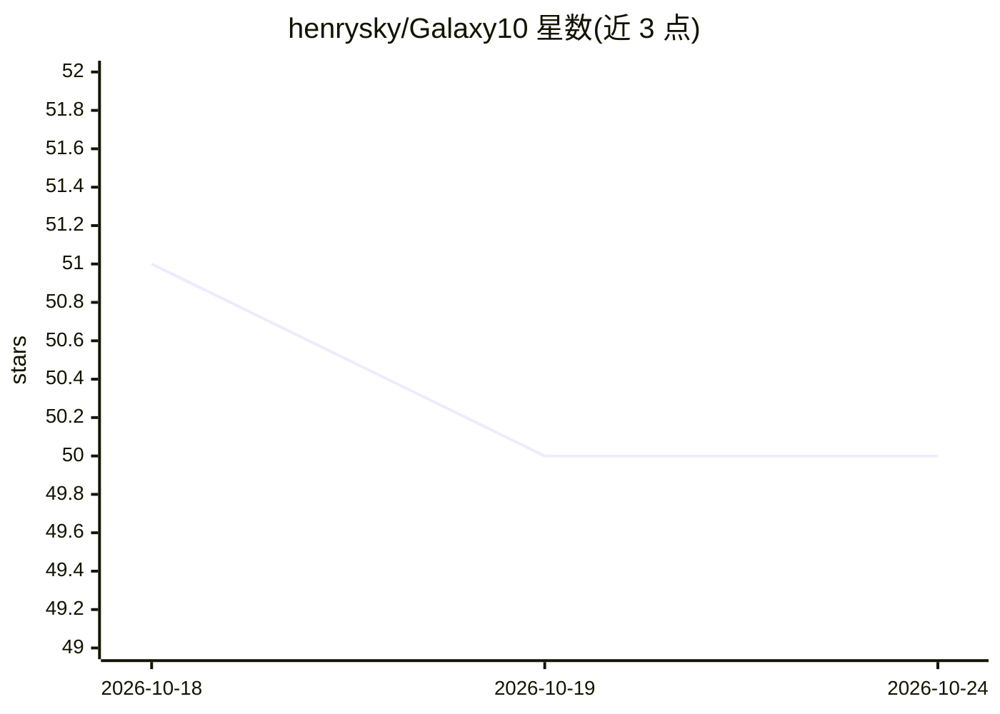

# henrysky/Galaxy10

⭐ 50 · Python · MIT · 推送 2026-07-21 · [GitHub](https://github.com/henrysky/Galaxy10) · [官网](https://astronn.readthedocs.io/en/stable/galaxy10.html) · 组织维护

**星系图像分类数据集：17,736 张 10 类星系图像供深度学习**

Galaxy10 DECaLS 是 CIFAR-10 风格的天文图像数据集，包含 17,736 张 256x256 像素彩色（g/r/z 波段）星系图像，按志愿者投票标注为 10 个形态类别（扰动、合并、光滑、棒旋、旋涡、侧向等）。图像来自 DESI Legacy Imaging Surveys，标签来自 Galaxy Zoo。数据以 HDF5 格式（2.54 GB）托管于 Zenodo 提供 SHA256 校验，仓库附坐标交叉匹配文件、图像下载脚本与数据集编译 Notebook。HDF5 含 images、ans、ra、dec、redshift、pxscale 列。

## 筛选速览

| 维度 | 判定 | 备注 |
|---|---|---|
| AI 角色 | `ai-knowledge` | 知识聚合/清单类 |
| 许可风险 | `permissive` | MIT |
| 部署形态 | `None` |  |
| 模型依赖 | — | README 未给出锁定关系 |
| 硬件要求 | — | 无带数字的原话,不猜 |
| 安装摩擦 | `low` | 无编译、无系统依赖或容器化 |
| 成熟度 | — | 结构信号不足 |

## 能力要点

- 17,736 张 256x256 彩色星系图像，10 个形态类别
- HDF5 格式含 ra/dec/redshift/pxscale 等元数据列
- 提供从 DECaLS DR8 下载原始图像的脚本与编译 Notebook
- 标签来自 Galaxy Zoo 志愿者投票，较原版 Galaxy10 过滤更严格

## 适用场景

- 我要为星系形态分类训练并测试深度学习模型
- 作为天文学课程的入门分类数据集
- 用提供的坐标文件与外部星表做交叉匹配研究

## 场景标签

 · 领域:天文学/机器学习数据集

## 证据(README 行号)

> L29: Galaxy10 DECaLS is a dataset contains 17736 256x256 pixels colored galaxy images (g, r and z band) separated in 10 
> L38:  Galaxy10 dataset (17736 images)

## 星数曲线

2026-10-18 51 → 2026-10-24 50（-1）

---
*卡片 v1 · prompt 1.4 · 生成 2026-10-24 · 置信度 high · 依据 README sha `30029a596231` · [字段定义](../../DATASET.md)*
