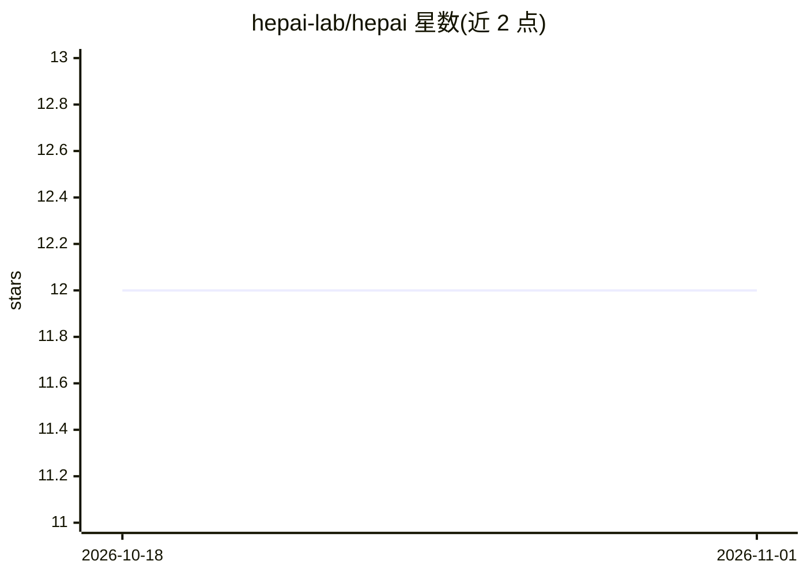

# hepai-lab/hepai

⭐ 12 · Python · 推送 2026-07-29 · [GitHub](https://github.com/hepai-lab/hepai) · [官网](https://ai.ihep.ac.cn) · 组织维护 · 中文 README

**面向高能物理的 AI 框架：统一接口访问模型、数据集与算力**

中科院高能所相关团队开发的 HepAI 框架（HAI），定位为高能 AI 平台的核心技术：集成高能物理领域的经典与 SOTA AI 算法，用户通过统一接口访问算法模型、数据集与计算资源，支持在 HPC 集群中使用；Client 可调用 GPT-3.5/GPT-4o、DALL·E 文生图及远程模型，并支持华为 NPU 服务器与 OpenDRSAI 智能体框架（v1.1.34 起 from hepai.agents）。以 pip 包安装，调用远程模型需在 HepAI 平台创建 api_key；README 中智能体部分标注 TODO，尚不完整。

## 筛选速览

| 维度 | 判定 | 备注 |
|---|---|---|
| AI 角色 | `ai-ecosystem` | LLM/agent 周边工具 |
| 许可风险 | `none` | — |
| 部署形态 | `library` | 以包/库形式分发 |
| 模型依赖 | — | README 未给出锁定关系 |
| 硬件要求 | — | 无带数字的原话,不猜 |
| 安装摩擦 | `low` | 无编译、无系统依赖或容器化 |
| 成熟度 | `idea` | |

## 能力要点

- 集成高能物理领域经典与 SOTA AI 算法的模型 Zoo 与数据集 Zoo
- 统一接口访问模型、数据集与算力资源，支持 HPC 集群使用
- Client 支持 GPT-4o/GPT-3.5、DALL·E 文生图与远程模型
- 支持华为 NPU 服务器与多智能体协作框架

## 适用场景

- 高能物理研究中调用领域 AI 模型与数据集
- 在 HPC 计算集群上使用 HepAI 算力资源
- 通过统一客户端调用 GPT-4o、DALL·E 等模型

## 场景标签

`模型网关` · 领域:Agent 开发

## 证据(README 行号)

> L9: HepAI提供了一个AI开源框架，是高能AI平台的核心技术，应用此技术可以加速多学科场景的科学研究，简化模型迭代和流程，是开发AI算法和应用的共性基础。
> L13: HepAI框架集成了高能物理领域的经典和最先进（SOTA）的人工智能算法。用户可以通过统一接口访问相关的算法模型、数据集和计算资源，使AI的应用变得简单高效。

## 星数曲线

2026-10-18 12 → 2026-11-01 12（+0）

---
*卡片 v1 · prompt 1.4 · 生成 2026-11-01 · 置信度 mid · 依据 README sha `8c48f216c307` · [字段定义](../../DATASET.md)*
