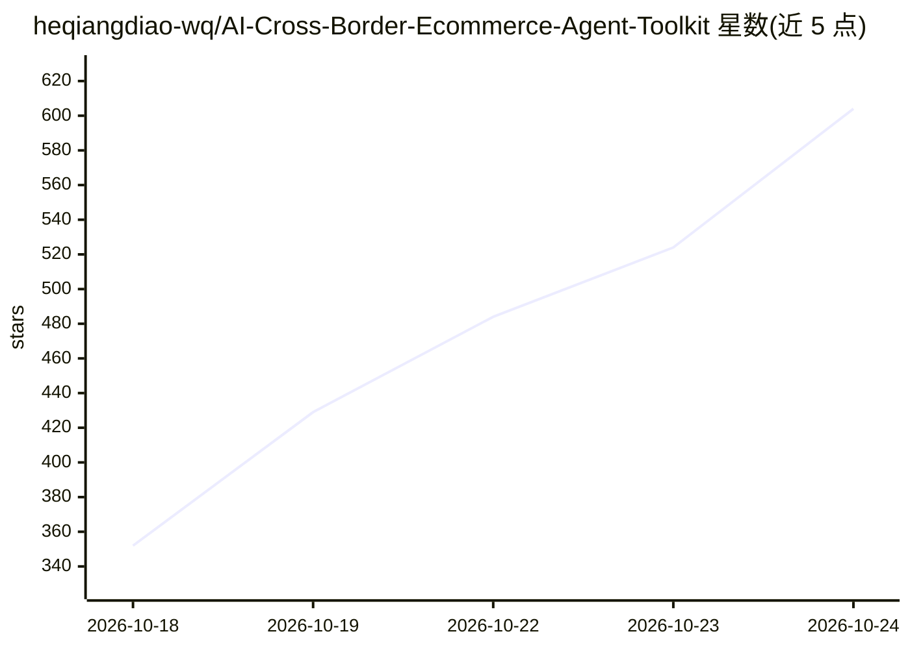

# heqiangdiao-wq/AI-Cross-Border-Ecommerce-Agent-Toolkit

⭐ 623 · Python · MIT · 推送 2026-10-18 · [GitHub](https://github.com/heqiangdiao-wq/AI-Cross-Border-Ecommerce-Agent-Toolkit) · 个人维护 · 中文 README

**跨境电商运营 Prompt/工作流工具箱：把 Shopee 运营 SOP 拆成 7 个 Agent 模块**

非软件、非 SaaS 的方法论资产仓库：将一份 38 页 Shopee 巴西站运营手册拆解为 7 个 Agent 模块（市场分析、产品策略、Listing/主图/短视频生成、广告优化、评论分析），每个模块交付标准 Prompt、输入模板与真实案例，用户复制模板填入产品信息后交给任意 LLM 运行，无需 API key 与环境安装。配套脚本计算集中度、价格带等指标，原始 SOP 中的灰产动作已识别并改写为合规替代方案。Shopee 与 Mercado Livre 为一等支持，Amazon/TikTok Shop/Shopify 字段已适配。

## 筛选速览

| 维度 | 判定 | 备注 |
|---|---|---|
| AI 角色 | `ai-knowledge` | 知识聚合/清单类 |
| 许可风险 | `permissive` | MIT |
| 部署形态 | `None` |  |
| 模型依赖 | — | README 未给出锁定关系 |
| 硬件要求 | — | 无带数字的原话,不猜 |
| 安装摩擦 | `low` | 无编译、无系统依赖或容器化 |
| 成熟度 | `idea` | |

## 能力要点

- 7 个 Agent 模块含 Prompt+输入模板+真实案例，构成分析→产出→回流的闭环链路
- 指标（集中度/价格带）由脚本计算，Agent 只负责解读
- 原始 SOP 灰产项已识别并改写为合规替代，附 Gap 登记表
- 整个文件夹可整体安装为 Skill（SKILL.md 入口）

## 适用场景

- 跨境卖家直接用模板+Prompt 生成可发布的 Listing 与主图/视频素材
- 把老手运营经验结构化，让产出稳定在可复核的下限
- 广告与评论数据回流后修正 Listing 并复测

## 场景标签

`提示工程` · 领域:Agent 开发

## 证据(README 行号)

> L11: 把**跨境运营 SOP 里沉淀的经验**，翻译成**可复制的 AI Agent 工作流**：一个标准 Prompt + 一份输入模板 + 一个真实案例，任何人都能拿去直接跑出可发布的商品素材。
> L70: 不需要 API key，不需要装环境。**三个文件就能跑。**
> L75: Step 3  把「系统 Prompt」+「任务 Prompt」+「填好的模板」丢给任意 LLM

## 星数曲线

2026-10-18 352 → 2026-10-24 604（+252）

---
*卡片 v1 · prompt 1.4 · 生成 2026-10-21 · 置信度 high · 依据 README sha `90bd1367db5e` · [字段定义](../../DATASET.md)*
