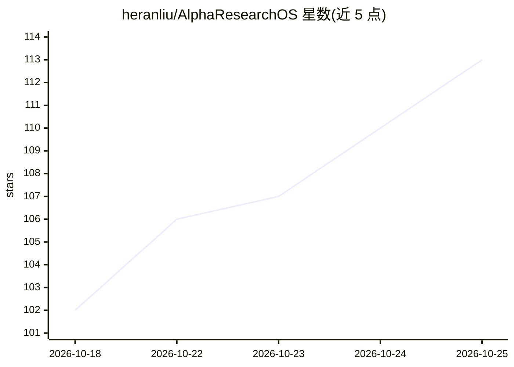

# heranliu/AlphaResearchOS

⭐ 114 · Python · MIT · 推送 2026-10-09 · [GitHub](https://github.com/heranliu/AlphaResearchOS) · 个人维护 · 中文 README

**本地量化研究工作台：接入模型 API 从 CSV 生成可审计策略**

基于 Python 3.11–3.13 的本地 Web 工作台（uv 运行，服务于 127.0.0.1:8765）：导入标准 OHLCV CSV（3–100 资产、默认需至少 468 个共同交易日），连接 Codex CLI、DeepSeek/Gemini/Ollama API 预设或兼容端点，由模型会话生成研究假设与特征表达式，训练 Ridge、直方图梯度提升等预测模型，经独立模型会话审查候选，按开发评分竞争后在留出集评估。支持预算控制（请求数/候选数/时间/token）、暂停恢复、因子库与研究报告导出。提供英文与简体中文界面，macOS/Linux 原生支持，Windows 需 WSL2。

## 筛选速览

| 维度 | 判定 | 备注 |
|---|---|---|
| AI 角色 | `ai-native` | 本体是模型或模型工具 |
| 许可风险 | `permissive` | MIT |
| 部署形态 | `None` |  |
| 模型依赖 | local-ok | 支持本地模型 |
| 硬件要求 | — | 无带数字的原话,不猜 |
| 安装摩擦 | `low` | 无编译、无系统依赖或容器化 |
| 成熟度 | — | 结构信号不足 |

## 能力要点

- 假设→特征+模型→开发评估→独立审查→迭代→留出集的研究闭环
- 读取标准 OHLCV CSV，支持 3–100 资产
- Codex CLI / DeepSeek / Gemini / Ollama / 自定义兼容端点接入
- 请求、候选、时间与 token 预算控制，可暂停恢复
- 因子库管理与研究报告导出

## 适用场景

- 量化研究者从自有行情 CSV 出发做假设驱动的因子研究
- 需要独立审查与留出集验证的可复现回测
- 管理并比较多候选策略的开发评分与成本敏感性

## 场景标签

`金融量化` · 领域:学习与行业

## 证据(README 行号)

> L13: AlphaResearchOS brings the quantitative research loop into one local workbench. Import a standard OHLCV CSV, connec
> L49: 2. **Connect a model.** Choose your authenticated **Codex CLI**, a DeepSeek/Gemini/Ollama API preset, or a custom c

## 星数曲线

2026-10-18 102 → 2026-10-25 113（+11）

---
*卡片 v1 · prompt 1.4 · 生成 2026-10-23 · 置信度 high · 依据 README sha `e3b8cdaff141` · [字段定义](../../DATASET.md)*
