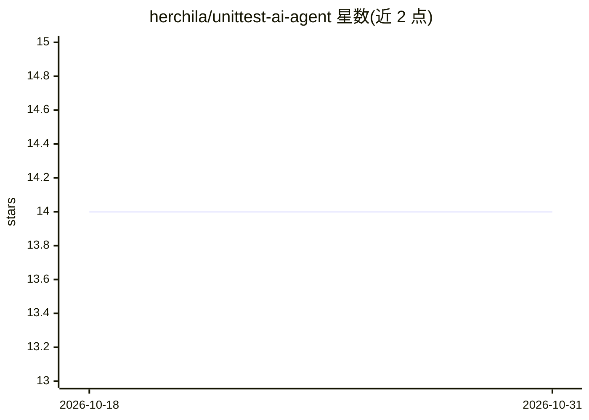

# herchila/unittest-ai-agent

⭐ 14 · Python · Apache-2.0 · 推送 2026-01-09 · [GitHub](https://github.com/herchila/unittest-ai-agent) · 个人维护

**用 OpenAI GPT 为 Python 代码自动生成 pytest 单元测试的 CLI 工具**

Python 命令行工具：分析源码文件的导入、函数与类上下文，构造 prompt 发送给 OpenAI GPT-4o，生成基于 pytest 的单元测试，经后处理适配项目结构后保存到对应目录。面向需要为 Python 函数和类补充测试的开发者。依赖 Python 3.9+、OpenAI API key，用 Poetry 管理依赖，prompt 模板可在 ut/prompts/ 目录自定义。项目处于活跃开发阶段。

## 筛选速览

| 维度 | 判定 | 备注 |
|---|---|---|
| AI 角色 | `ai-native` | 本体是模型或模型工具 |
| 许可风险 | `permissive` | Apache-2.0 |
| 部署形态 | `None` |  |
| 模型依赖 | — | README 未给出锁定关系 |
| 硬件要求 | — | 无带数字的原话,不猜 |
| 安装摩擦 | `low` | 无编译、无系统依赖或容器化 |
| 成熟度 | `idea` | |

## 能力要点

- 自动抽取源码的导入、函数与类上下文构造 prompt
- 调用 OpenAI GPT-4o 生成 pytest 测试套件
- 生成结果经后处理适配项目目录结构
- prompt 模板可自定义编辑

## 适用场景

- 为已有 Python 函数与类批量补充单元测试
- 通过自定义 prompt 模板调整测试生成风格
- 在 CI 流程中快速生成测试覆盖基础代码

## 场景标签

`代码生成` · 领域:编码与开发

## 证据(README 行号)

> L11: Unittest AI Agent is a Python tool that automatically generates comprehensive unit tests for your Python functions 
> L17: - **LLM Integration:** Sends code context to OpenAI GPT-4o to generate high-quality unit tests.

## 星数曲线

2026-10-18 14 → 2026-10-31 14（+0）

---
*卡片 v1 · prompt 1.4 · 生成 2026-10-31 · 置信度 high · 依据 README sha `a55457c5b32e` · [字段定义](../../DATASET.md)*
