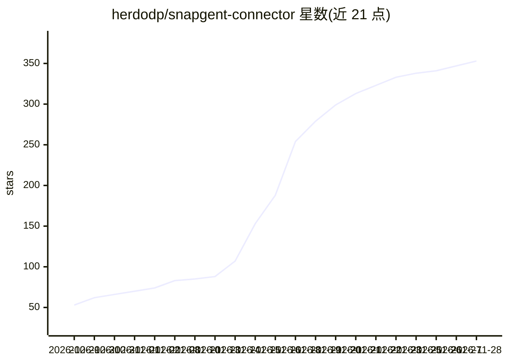

# herdodp/snapgent-connector

⭐ 353 · JavaScript · GPL-3.0 · 推送 2026-11-26 · [GitHub](https://github.com/herdodp/snapgent-connector) · [官网](https://herdodp.github.io/snapgent-connector/) · 个人维护

**把浏览器 AI 聊天接入 VS Code 等 MCP 目标的连接器**

snapgentV3 由浏览器扩展加本地桥两部分组成：在支持的 AI 聊天网页中，用户用自然语言描述任务，扩展检测 AI 回复中的命令并经 WebSocket 转发给本地桥，桥再路由到选定的 MCP 服务器（默认 VS Code，自动使用当前打开的工作区），结果回传聊天继续对话。支持 Chrome/Edge/Firefox，另提供 Windows 独立 Electron 桌面版（内置 AI 浏览器与桥）。免 API key、免订阅、免登录。

## 筛选速览

| 维度 | 判定 | 备注 |
|---|---|---|
| AI 角色 | `ai-ecosystem` | LLM/agent 周边工具 |
| 许可风险 | `viral` | GPL-3.0 |
| 部署形态 | `desktop` | 安装包/桌面程序 |
| 模型依赖 | locked-api |  |
| 硬件要求 | — | 无带数字的原话,不猜 |
| 安装摩擦 | `low` | 无编译、无系统依赖或容器化 |
| 成熟度 | — | 结构信号不足 |

## 能力要点

- 通过本地桥把 AI 聊天网页接入 MCP 目标（VS Code/FigCraft/EffectCraft/Word）
- 自动检测当前打开的 VS Code 工作区
- 支持 11 个 AI 聊天网站（ChatGPT、Claude、Gemini、Kimi、Grok 等）
- 提供 Windows Electron 独立桌面版，无需自装 Python/Node.js

## 适用场景

- 用网页 AI 聊天直接操作当前 VS Code 项目
- 通过对话生成和编辑 .docx 文档
- 从聊天页控制 FigCraft/EffectCraft 等工具

## 场景标签

`编码 Agent` `AI 写作` · 领域:编码与开发

## 证据(README 行号)

> L21: snapgentV3 is a browser extension plus a local bridge that connects a normal AI chat to **VS Code**. It automatical
> L90: ## `02` &nbsp; Supported AI providers

## 星数曲线

2026-10-29 53 → 2026-11-28 353（+300）

---
*卡片 v1 · prompt 1.4 · 生成 2026-11-25 · 置信度 mid · 依据 README sha `c3e730fc2784` · [字段定义](../../DATASET.md)*
